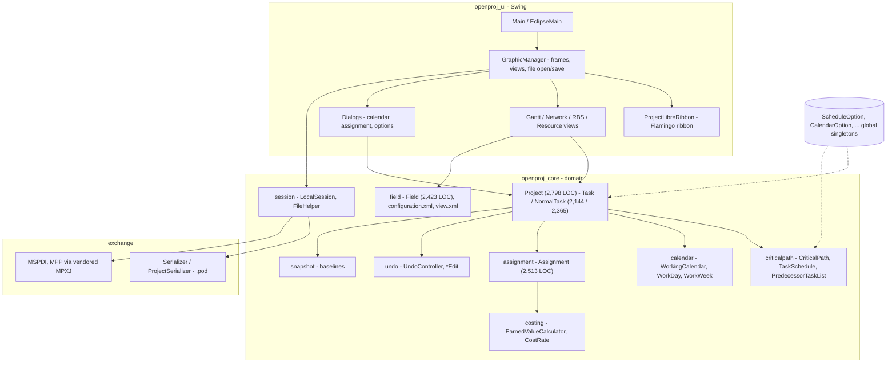
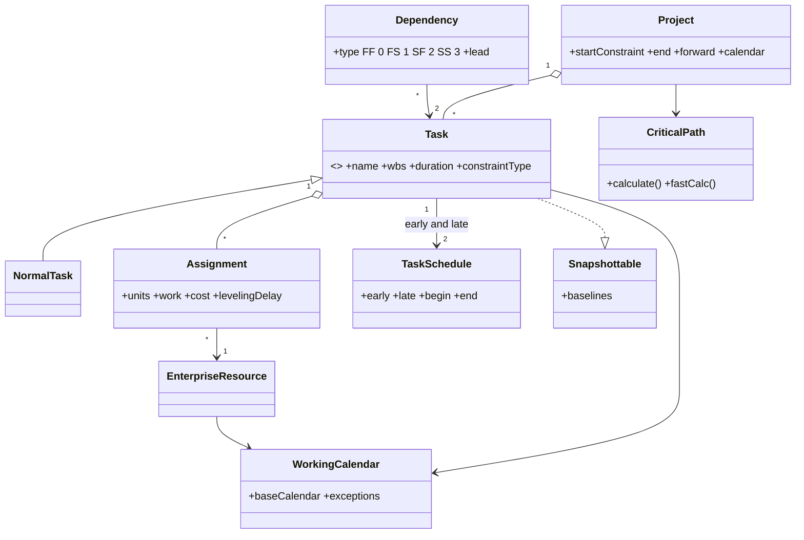

# 01 · Reverse-Engineering Report — ProjectLibre (as found)

> **Subject:** `github.com/smartqubit/projectlibre` (fork of ProjectLibre, itself the successor of OpenProj), cloned 2026-11-08, shallow clone of the default branch.
> **Method:** static analysis of source, build files, configuration XML, bundled sample files and licence texts. **The application was not built or run**, and no profiler or dynamic tracing was used. Every number below was measured with `find`/`wc`/`grep` on the clone; every behavioural claim cites a file. Where I infer rather than observe, the text says *inferred*.

---

## 1. What the product is

ProjectLibre is a **single-user Java Swing desktop application** that positions itself as an open-source replacement for Microsoft Project: Gantt, network (PERT) and resource-breakdown views, earned-value costing, resource assignment and MS-Project file import/export. It descends from **OpenProj (Projity, 2006)**; the code base still carries the Projity package names (`com.projity.*`) and a 2006-era design.

A second, smaller tree (`projectlibre_core`, package `com.projectlibre.*`, 83 files) is an **unfinished rewrite** of the core model. It is not wired into the application (see D-08).

## 2. Inventory

| Module | Files | LOC | Role | Notes |
|---|---:|---:|---|---|
| `openproj_core` | 544 | 88,368 | Domain model, scheduling, calendars, costing, fields, undo, sessions | **The valuable part.** First-party. |
| `openproj_ui` | 446 | 100,690 | Swing UI, ribbon, Gantt/network/RBS views, dialogs, print | Includes **vendored** Flamingo ribbon (141 files / 38,290 LOC) and Batik (11 / 2,336). First-party UI ≈ 291 files / 59,615 LOC. |
| `openproj_exchange` | 61 | 11,321 | Import/export glue, `.pod` serializer, MSPDI adapter | |
| `projectlibre_exchange` | 543 | 265,999 | **Vendored copy of MPXJ** (`net.sf.mpxj.*`) — readers/writers for MPP, MSPDI, MPX, Primavera, Planner, Asta | **LGPL 2.1** (header of `MPXJException.java`). |
| `projectlibre_core` | 83 | 10,567 | Re-write of core model (`Node`, `Hierarchy`, `Field`, `WorkCalendar`, `Scheduler`) | Largely interfaces/stubs. |
| `openproj_reports` | 6 | 1,619 | JasperReports-based reports | |
| `openproj_contrib` | 10 | 3,644 | Build helpers + bundled JARs (Groovy, XStream 1.1.1, iText, forms …) | |
| `openproj_build` | – | – | Ant build, installers (deb, rpm, mac, wix), sample `.mpp`/`.pod` files | |
| **Total** | **1,693** | **482,208** | | **≈175,600 LOC first-party** after removing MPXJ, Flamingo, Batik |

Build system: **Apache Ant**; `openproj_build/build.xml` compiles with `source="1.5" target="1.5"` (lines 47 and 66) — a 2004-era Java level.

Third-party usage by import count (first-party code only): Flamingo 435, Apache Commons 237, JGoodies Forms 114, MPXJ 47, Batik 28, JFreeChart 18, iText 6, nachocalendar 5, Trident 4, JasperReports 4.

## 3. Architecture as found

**Reading the diagram.** The domain model is a single in-memory object graph rooted at `Project`. The UI binds directly to domain objects through the `Field` metadata system; there is no service layer, no API and no persistence layer other than whole-file serialization. Global singletons (dotted) carry options that the scheduling code reads implicitly — this is the main obstacle to running two projects with different options in one process, and to running the engine on a server.

### 3.1 Domain model (key types)

### 3.2 Scheduling engine as found

Files: `pm/criticalpath/CriticalPath.java` (636 LOC), `TaskSchedule.java` (719), `PredecessorTaskList.java` (345), `pm/scheduling/*` (1,835 LOC total), `pm/dependency/*` (1,475).

What the code does (observed in `CriticalPath.fastCalc` / `doPass`):

1. **Sentinels.** A synthetic *start* and *finish* task bracket the network so every real task has at least one predecessor and successor (`startSentinel`, `finishSentinel`).
2. **Ordered predecessor list.** `PredecessorTaskList` keeps tasks in a precedence-respecting order; passes iterate it forward or in reverse.
3. **Pass 1 – forward** over the list computes *early* dates and assigns them. If the project contains *reverse-scheduled* (ALAP/backward) tasks, only early dates are computed in this pass (`earlyOnly`).
4. **Pass 2 – backward** computes *late* dates from the finish sentinel, **only if** the change "affects the critical path" (`affectsCriticalPath`), which is how the engine avoids recomputing everything on small edits.
5. **Pass 3 – forward again** is run when reverse-scheduled tasks exist, to assign final dates.
6. **Invalidation** is a monotonically increasing *calculation-state counter*; a task is recalculated only if its stored counter is ≥ the pass counter.
7. **Triggering.** `CriticalPath` implements `ObjectEvent.Listener`; edits to tasks/dependencies/calendars emit `ObjectEvent`s that call `objectChanged`, and `MultipleTransaction` batches events.

Vocabulary preserved by the code (all to be preserved by the new product for file-compatibility):

| Concept | Legacy encoding | Source |
|---|---|---|
| Dependency types | `FF=0, FS=1, SF=2, SS=3` | `pm/dependency/DependencyType.java` |
| Constraint types | `ASAP=0, ALAP=1, MSO=2, MFO=3, SNET=4, SNLT=5, FNET=6, FNLT=7` (ids deliberately equal MPX) | `pm/scheduling/ConstraintType.java` |
| Scheduling rules | `FIXED_UNITS=0, FIXED_DURATION=1, FIXED_WORK=2` (strategy objects `FixedUnits`, `FixedDuration`, `FixedWork`) | `pm/scheduling/SchedulingType.java` |
| Options | `effortDriven=true`, duration entered in days, work in hours | `options/ScheduleOption.java` (**global singleton**) |

### 3.3 Other subsystems

| Subsystem | Finding |
|---|---|
| **Calendars** | `WorkingCalendar` (714 LOC) with base-calendar inheritance, `WorkDay`/`WorkWeek`/`WorkRange`, exception days; `CalendarService` (591). Calendar results are cached and invalidated via `invalidate()`. |
| **Assignments** | `Assignment` (2,513 LOC) + `AssignmentDetail` (1,154): time-distributed work/cost; `CanBeLeveled.levelingDelay` field exists and a leveling UI action exists (`MenuActionConstants`, `GraphicManager`). *I did not locate the leveling algorithm in the packages I read — treat leveling quality as unverified.* |
| **Costing / EVM** | `EarnedValueCalculator` singleton; **defect D-01** below. `CostRateTable` for time-varying rates. |
| **Baselines** | `Snapshottable` / `DataSnapshot` / `BaselineScheduleFields` — a per-object snapshot mechanism (`TaskSnapshot`). |
| **Undo/redo** | `UndoController` + 20 `*Edit` classes (`ScheduleEdit`, `SplitEdit`, `DependencySetFieldsEdit`…). Command-style undo; a design worth keeping conceptually. |
| **Fields & views** | `Field.java` (2,423 LOC) + `configuration.xml` (836 lines, **183 `<field>` definitions**) + `view.xml` (1,702 lines). Columns, forms and reports are *metadata-driven*. Strong idea; implementation is monolithic. |
| **Outline / WBS** | `grouping/core` (`Node`, `NodeBridge`, `OutlineCode`) – generic hierarchical node model. |
| **Scripting** | `script/` + `scripting/formulas` with bundled Groovy/BSF 2006-era JARs for custom-field formulas. Arbitrary-code risk (D-10). |
| **Reports** | JasperReports + JFreeChart. |
| **Persistence** | Native **`.pod`**: the bundled samples (`openproj_build/resources/samples/*.pod`) are identified by `file(1)` as **“Java serialization data, version 5”** (D-04). MS-Project formats go through the vendored MPXJ. |
| **Server layer** | `openproj_core/.../server/` only contains `access/ErrorLogger`, `PartnerInfo` and `data/*` DTOs — the hosted multi-user server of the original product is **not present** (D-09). |

## 4. Defect & debt register

Severity: **H** = correctness/security/legal, **M** = blocks the target architecture, **L** = hygiene.

| ID | Sev | Finding | Evidence | Consequence for the new design |
|---|:--:|---|---|---|
| D-01 | M | **Latent earned-value defect:** the public no-arg `EarnedValueCalculator.bcwp(ev)` returns `ev.acwp(...)`, i.e. earned value (BCWP) is reported as *actual cost*. A grep of the whole tree finds **no caller of that overload** (the project-level `cv/sv/eac` fields call the ranged overloads, which use `ev.bcwp(start,end)`), so the defect is dormant here but is a trap for any consumer of the public API. | `openproj_core/.../pm/costing/EarnedValueCalculator.java:80-82`; callers `pm/task/Project.java:1340-1346` | New engine defines EV = %complete × BAC and has a regression test (`engine.test.ts`, “EVM: EV is percent-complete × BAC”). I did not verify the ranged `bcwp(start,end)` implementations in `TimeDistributedDataConsolidator`/`TaskSnapshot`. |
| D-02 | M | Ant build targets Java 1.5; no Maven/Gradle; no dependency management; JARs committed. | `openproj_build/build.xml:47,66`; `openproj_contrib/lib/*.jar` | Cannot adopt modern JVM features/security fixes without a rebuild of the toolchain. |
| D-03 | M | **155 `static getInstance()` singletons** in core+UI; options (`ScheduleOption`, `CalendarOption`, …) are process-global. | grep `static .*getInstance\(` | Engine cannot be hosted multi-tenant or run two projects with different options. New engine is a pure function of its input. |
| D-04 | **H** | `.pod` is **Java native serialization** (v5). Version-fragile (class layout), not interoperable, and a **deserialization attack surface** when opening files from untrusted sources. | `file(1)` on samples; 61 core files reference `Serializable`/`ObjectOutputStream` | New native format is JSON/JSONL in a zip; legacy `.pod` is imported only inside a sandboxed converter (doc 13). |
| D-05 | M | **Test coverage is effectively nil:** one test class in the whole repo (`MicrosoftImporterTest`). The scheduler has no unit tests. | `find . -path '*test*' -name '*.java'` | Behaviour cannot be pinned by tests; we must build a **golden corpus** from black-box runs (doc 13). |
| D-06 | L | 750 `TODO/FIXME/XXX/HACK` markers; in-code workarounds, e.g. “in reverse scheduling, I see some parents have 0 or 1 as their dates. This is a workaround.” | `CriticalPath.doPass` | Indicates fragile areas: reverse scheduling and summary tasks. |
| D-07 | M | Large third-party source vendored into the tree (MPXJ 266k LOC; Flamingo 38k; Batik 2k) and mixed with first-party code. | module sizes above | Obscures ownership/licensing; upgrade path blocked. New design consumes such libraries as versioned dependencies or isolated services. |
| D-08 | M | The "next-gen" core (`projectlibre_core`) is unfinished: `Scheduler`/`ScheduleChangedEvent` are empty stubs; `OpenProjExporter.exportProject` **returns `null`**. | `projectlibre_core/.../scheduler/*`, `openproj_exchange/.../OpenProjExporter.java` | Do not build on it; the architectural *intent* (Node/Hierarchy/Field/TimeInterval) informs the new domain model. |
| D-09 | M | No server/multi-user capability in this tree. | `server/` contents | Collaboration, API and web delivery are net-new capabilities. |
| D-10 | **H** | Bundled **XStream 1.1.1** and 2006-era Groovy/ASM JARs. Old XStream and dynamic Groovy evaluation are well-known deserialization / code-execution risks. *Whether these paths are reachable from user-controlled files was not traced — verify before any reuse.* | `openproj_contrib/lib/groovy/*` | New formula language is a sandboxed expression grammar, no host-language eval (doc 06 §9.1). |
| D-11 | M | God classes: `Project` 2,798 LOC, `Assignment` 2,513, `NormalTask` 2,365, `Field` 2,423, `Task` 2,144. | `wc -l` | Domain behaviour is entangled with UI binding and events; decompose by bounded context. |
| D-12 | M | Concurrency: 88 lines using `Thread`/`SwingWorker`/`synchronized` in core; engine mutates shared task objects in place. | grep | No safe parallel recalculation (e.g. Monte Carlo) — the new engine is immutable-in/immutable-out. |
| D-13 | **H** (legal) | **CPAL 1.0 licence with mandatory attribution** (“ProjectLibre, the updated version of OpenProj”, logo on every screen) and a dual “ProjectLibre End-User License” alternative. | `openproj_build/license/license.rtf`, source headers | Copying code into a differently-licensed product triggers attribution/network-use obligations. Hence ADR-001 (clean-room). |

## 5. Behavioural specification extracted

These are the behaviours the new product must reproduce (or consciously change). Each is verified in the new engine's tests or listed as a corpus case in doc 13.

| # | Behaviour | Legacy evidence | New-engine status |
|---|---|---|---|
| B1 | Four dependency types with lead/lag; negative lag = lead | `DependencyType`, `Dependency` | Implemented + tested |
| B2 | Eight constraint types; hard constraints (MSO/MFO) win over dependencies and raise a conflict | `ConstraintType`; ids equal MPX | Implemented + tested (`MSO_VIOLATED`) |
| B3 | Forward pass → early; backward pass → late; float = late − early on the task's calendar; critical = float ≤ 0 | `CriticalPath` | Implemented + 300-graph property test |
| B4 | Summary tasks derive dates from children; links to summaries are not scheduled | `assignDatesFromChildren` | Implemented + tested (`LINK_TO_SUMMARY`) |
| B5 | Fixed-units / fixed-duration / fixed-work with effort-driven option | `SchedulingType`, `FixedUnits`… | **Designed** (doc 06 §6), not in reference engine |
| B6 | Working-time arithmetic over calendars with exceptions and inheritance | `WorkingCalendar` | Calendars + exceptions implemented; inheritance designed |
| B7 | Incremental recalculation on edit | `calculationStateCount`, `affectsCriticalPath` | **Designed** (doc 06 §7); reference engine recomputes fully (0.66 s at 50k tasks) |
| B8 | Baselines per object; EVM from baseline + actuals | `Snapshottable`, `EarnedValueCalculator` | EVM formulas implemented (correct EV); baselines in schema |
| B9 | Command-style undo/redo | `undo/*Edit` | Designed as inverse-command log (doc 04, 09) |
| B10 | Metadata-driven columns/views/reports | `configuration.xml`, `view.xml` | Designed (custom-field + view definitions, doc 05, 09) |

## 6. What is worth keeping

* **Event-driven incremental scheduling with batching** (`MultipleTransaction`) — right idea; re-implemented with an explicit dependency graph instead of mutable counters.
* **Command-pattern undo** — kept as inverse commands, which also serve collaboration.
* **Metadata-driven field/view system** — kept as declarative definitions served by the API.
* **MS-Project vocabulary and IDs** — kept for lossless import/export.
* **Snapshot-based baselines** — kept as immutable baseline tables.

## 7. Legal and clean-room protocol

1. The licence is **CPAL 1.0** (a Mozilla-1.1-derived licence with network-use and attribution clauses) with an alternative ProjectLibre EULA. **This report is engineering analysis, not legal advice; obtain counsel's review before any reuse of code.**
2. **No ProjectLibre/OpenProj source was copied into the new design or reference engine.** The engine was written from the published CPM/PDM method and the observable MS-Project-style vocabulary.
3. Recommended **two-team separation** for the build phase: *analysts* may read the legacy code and produce specifications and test vectors (docs 01, 06, 13); *implementers* work only from those specifications and the black-box golden corpus.
4. File-format compatibility (MSPDI XML, MPX, `.mpp`) is achieved via **published formats** and MPXJ as a separately-licensed, isolated converter, not by linking legacy code.
5. If any legacy attribution is ever required, it must follow Exhibit B of the licence text in `openproj_build/license/license.rtf`.

## 8. Limits of this analysis

* Static only; the application was not compiled or run, so UI behaviour, performance and runtime defects are untested.
* About 15 % of first-party files were read in full or in large part (engine, calendars, dependencies, costing, session/exchange headers); the remainder were inventoried by size, naming and grep. Statements about unread areas are marked *inferred* or *unverified*.
* The “reverse-engineer-anything” topic page was used for **method**, not for code: its listed projects (e.g. *awesome-reverse-engineer-anything*, *rea-pro-max*, *ReaFuse*) describe agent-driven analysis plus **behavioural verification of rebuilds**. We adopt that principle — specification first, then a corpus-based parity test — but I reviewed only the topic page's one-line descriptions, not those repositories' code.
