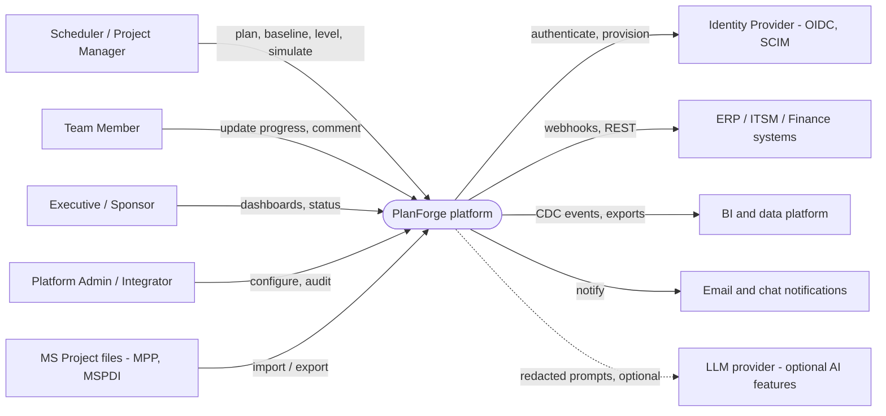
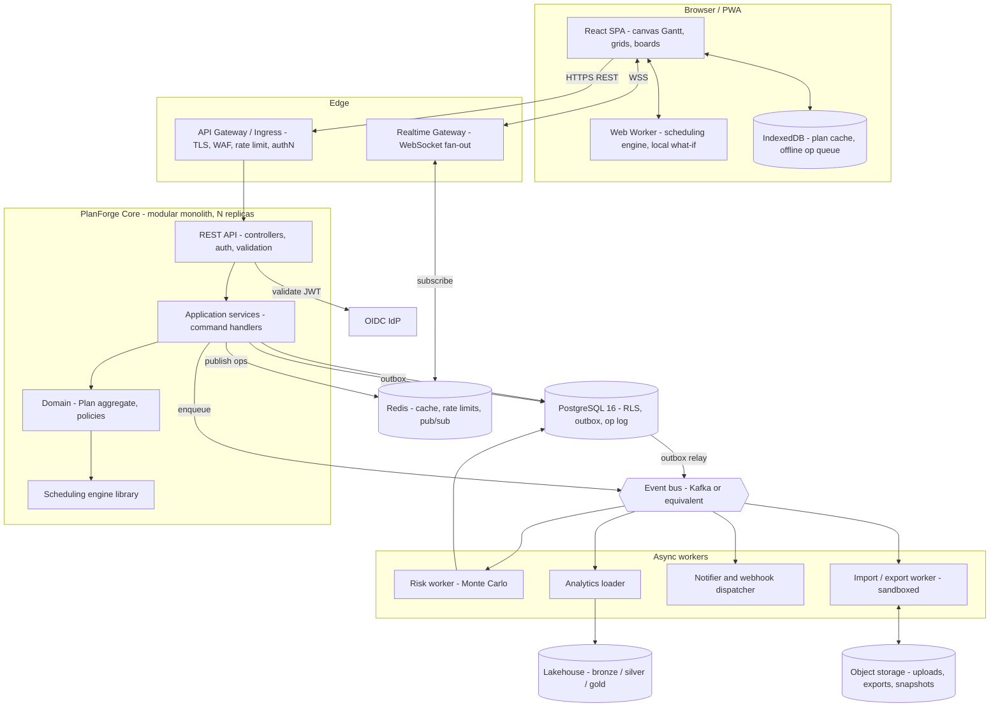
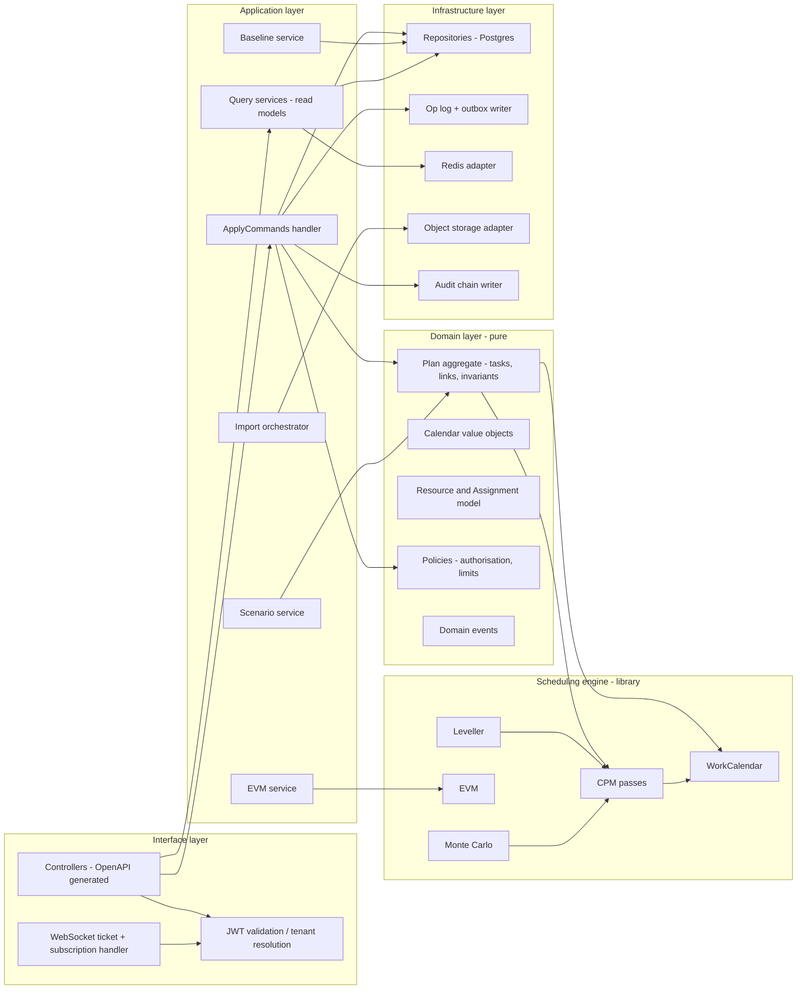
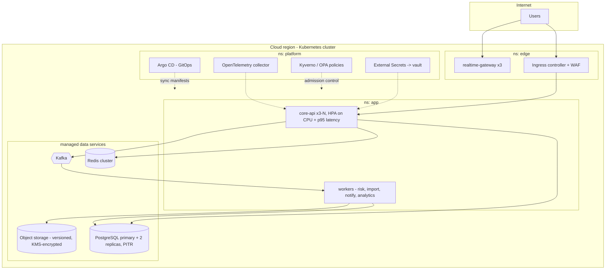

# 04 · Solution Architecture

Notation: C4 model (Context → Container → Component), drawn as Mermaid flowcharts so diagrams are text, diff-able and renderable in any Markdown viewer. Decisions are recorded in doc 15 (ADRs); the reasons behind each choice are in the **Notes** under each diagram.

## 1. Architecture drivers

| Driver | Consequence |
|---|---|
| Scheduling must be **deterministic and fast** | Pure engine library, no I/O, no globals; same code in browser worker and server (ADR-002) |
| Plans are **globally constrained graphs** (acyclic, calendar-dependent) | Server-sequenced command log, not free-form CRDT merging (ADR-005) |
| **Real-time** collaboration on 50 k-row plans | Optimistic client + authoritative server; virtualised canvas UI; delta broadcasting |
| **Untrusted files** (MPP, MSPDI, `.pod`) | Quarantined import pipeline; sandboxed parsers (ADR-007) |
| **Multi-tenant SaaS and self-hosted** | Database-enforced tenant isolation (RLS); Kubernetes-first packaging; cloud adapters |
| Small team, long-lived product | **Modular monolith** with enforced module boundaries; extract services only on evidence (ADR-003) |

## 2. Level 1 — System context

**Notes.** PlanForge owns *plan data and scheduling*; identity stays in the customer's IdP (no passwords stored). The LLM link is dotted because AI is optional, off by default per tenant, and receives only redacted task text (doc 11 §B5).

## 3. Level 2 — Containers

**Notes.**
* **Why a modular monolith** (ADR-003): the Plan aggregate, engine, authorisation and audit must commit in *one* transaction. Splitting them early would trade a simple ACID commit for distributed sagas with no scaling benefit — plans, not requests, are the unit of contention.
* **Web Worker engine**: the browser runs the *same* engine for instant feedback; the server's result is authoritative and shipped back as `schedule.delta` (a checksum of client vs server dates doubles as a continuous consistency test).
* **Workers are separate deployables** because they are CPU-heavy (Monte Carlo), memory-risky (parsers of untrusted files) or I/O-bound (webhooks) and need different scaling and sandboxing.
* **Redis** holds *derived/ephemeral* data only (cache, pub/sub, presence). Losing it never loses plan data.

## 4. Level 3 — Components inside the Core

**Notes.** Dependencies point **inward**: Interface → Application → Domain → Engine; Infrastructure implements interfaces declared by Application (ports/adapters). The Domain and Engine layers import nothing from frameworks — they can be unit-tested in milliseconds and ported (e.g. to a JVM) without touching the rest. A lint rule (dependency-cruiser) fails CI on any inward-violating import.

## 5. Deployment view

**Notes.** Three replicas minimum across availability zones with pod anti-affinity; read replicas serve list/report queries; the primary serves commands. Self-hosted customers receive the same Helm chart with bundled Postgres/Redis (ADR-009).

## 6. Technology stack (with the reason for each)

| Concern | Choice | Why (and the alternative rejected) |
|---|---|---|
| Language (all tiers) | **TypeScript 5** | One language lets the engine run in browser and server. *Rejected:* JVM (excellent for banks, but would need a second engine implementation or GraalJS) — a JVM port stays possible because the engine is dependency-free. |
| Frontend | React 18, Vite, TanStack Query, Zustand (normalised store), canvas renderer | Component ecosystem; virtualisation requirement rules out DOM-only grids |
| Backend | Node 22 LTS, Fastify, Zod (runtime validation), OpenAPI generated from schemas | Low overhead, schema-first |
| Database | PostgreSQL 16 | ACID, RLS, JSONB for custom fields, partitioning (doc 05) |
| Cache / pub-sub | Redis 7 | Presence, cache, rate limits |
| Messaging | Kafka-compatible (Redpanda/Kafka) | Replay for analytics; outbox pattern |
| Object storage | S3-compatible | Uploads/exports/snapshots |
| AuthN | OIDC (Entra ID, Keycloak, Okta …), SCIM 2.0 | No local passwords |
| Observability | OpenTelemetry → Prometheus/Grafana/Tempo/Loki | Vendor-neutral |
| Packaging | OCI images, Helm, Argo CD, Terraform | GitOps |

## 7. Cross-cutting design

### 7.1 Concurrency and consistency
* **Plan version.** `project.plan_version` increments on every committed batch. A client sends `expectedPlanVersion`; on mismatch the server **rebases** when the incoming commands commute with the intervening ones (e.g. edits to different tasks), otherwise returns `409 VERSION_CONFLICT` with the new commands so the client can replay. Details: doc 07 §4, ADR-005.
* **Row locking.** Commits take `SELECT … FOR UPDATE` on the `project` row only (one writer per plan at a time; many readers). Hold time is dominated by the engine run (reference engine: 143 ms for a *full* 10 k-task recalculation; the incremental path in doc 06 §7 targets far less).
* **Idempotency.** `plan_op(project_id, client_op_id)` is unique; a retried request returns the stored result.

### 7.2 Caching strategy (explicit)
| Data | Where | TTL / invalidation |
|---|---|---|
| Plan snapshot per `(project, planVersion)` | Redis (compressed) | Immutable key → no invalidation; evicted LRU |
| Calendar definitions | In-process LRU | Versioned by `updated_at` |
| Authorisation decisions | In-process, 30 s | Invalidated by membership-change events |
| Query results (lists, dashboards) | HTTP `ETag` + Redis | Event-driven on `plan.changed` |
| Static assets | CDN, content-hash filenames | `immutable` |

### 7.3 Performance & N+1 avoidance
* The plan is always loaded as **three set-based queries** (tasks, links, assignments) by `project_id` — never per-task lookups. Repository methods return arrays; the aggregate builds indices in memory.
* List endpoints use **keyset pagination** (`(sort_key, id)` cursors), not OFFSET.
* Writes are **diff-based**: only changed rows are updated using a single multi-row `UPDATE … FROM (VALUES …)`.

### 7.4 Resilience
| Pattern | Applied to |
|---|---|
| **Timeouts** everywhere (default 2 s DB, 5 s outbound) | all remote calls |
| **Retries with jitter** (max 3, idempotent calls only) | Redis, object storage, webhook delivery (exponential up to 24 h) |
| **Circuit breaker** | LLM provider, IdP JWKS fetch, webhook endpoints (per-endpoint) |
| **Bulkheads** | Separate worker pools and queues for risk, import, notify; per-tenant concurrency caps |
| **Backpressure** | Realtime gateway drops presence before plan ops; API sheds load with `429` + `Retry-After` |
| **Graceful degradation** | If Redis is down: no presence/cache, writes still succeed; if Kafka is down: outbox accumulates |

### 7.5 Multi-tenancy
Every tenant-owned table has `tenant_id` and an RLS policy (doc 05). The application sets `SET LOCAL pf.tenant_id` per transaction; the DB role used by the app **cannot bypass RLS** (verified in the schema test: cross-tenant insert fails, unset tenant sees 0 rows).

### 7.6 Undo/redo
Each applied command yields an *inverse command* stored in the op log (`updateTask` stores the previous values). Per-user undo submits the inverse as a **new** command (so it is audited, sequenced and broadcast); if a later command by someone else touched the same field, the undo is rejected with a clear message instead of clobbering their work.

### 7.7 Configuration & feature flags
12-factor configuration through environment and a typed config schema validated at start-up (fail fast). Feature flags (OpenFeature) gate R2/R3 features per tenant.

## 8. Performance SLAs (service level objectives)

| Operation | SLO (p95) | Budget notes |
|---|---|---|
| `POST /commands` (≤ 50 commands, ≤ 10 k-task plan) | 300 ms | DB 40 ms + engine 100 ms + write 80 ms |
| `GET /plan` (10 k tasks, cached) | 400 ms | ~1.2 MB gzip |
| `GET /tasks` page of 100 | 80 ms | Index-only |
| `POST /schedule` (what-if) | 500 ms | stateless |
| Realtime fan-out (commit → peer receives) | 250 ms | Redis pub/sub |
| Risk run, 5 000 iterations, 2 k tasks | < 60 s | Worker, parallel over cores |
| Import 5 MB MSPDI | < 30 s | async job |

Capacity model: these targets are **planning assumptions, not measurements**. Command throughput per pod will be derived from the k6 load test in staging; with a full-recalc engine at ~140 ms per 10 k-task command a single plan can sustain only ~7 commands/s, which is why batching (up to 1 000 commands per request) and the incremental path (doc 06 §7) are mandatory before R2.
