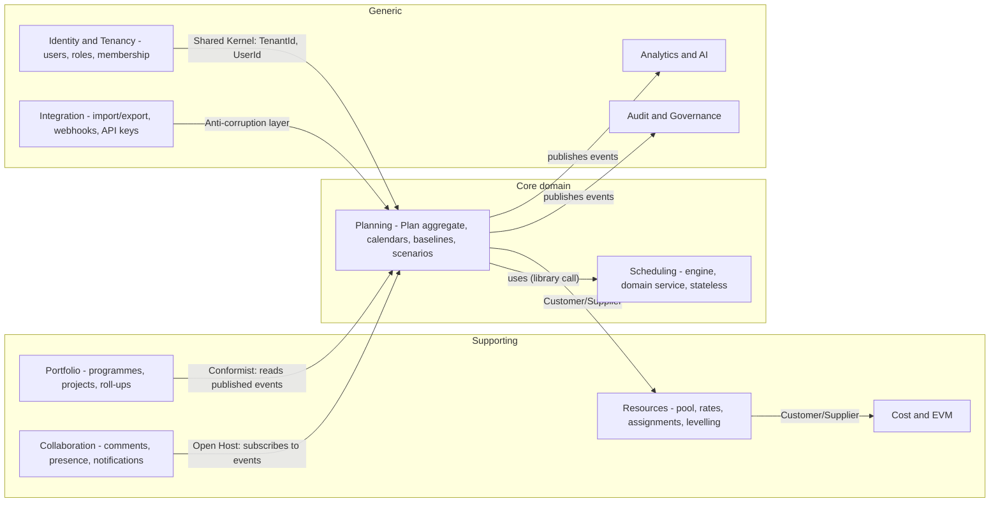
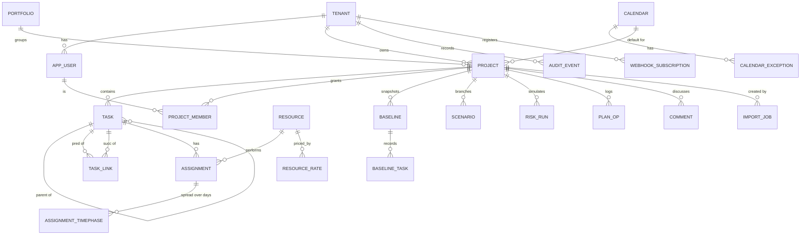

# 05 · Domain Model and Data Model

Standards applied: Clean Architecture + DDD (aggregates, bounded contexts, ubiquitous language), repository pattern, transactional integrity, idempotency. The physical DDL is `db/schema.sql` — **executed successfully against PostgreSQL 16** (28 tables, 21 with forced RLS; cross-tenant insert rejected, audit update rejected).

## 1. Bounded contexts



**Context-mapping notes.** *Planning* is the only context that mutates tasks/links. *Integration* is an **anti-corruption layer**: foreign models (MSPDI, `.pod`, CSV) never leak into the domain — importers translate to commands. *Portfolio* and *Analytics* are conformist read-side consumers of events, so they can be rebuilt from the event stream.

## 2. Ubiquitous language

| Term | Meaning | Not to be confused with |
|---|---|---|
| **Plan** | The consistent set of tasks, links, assignments and calendars of one project at a `planVersion` | “Project” (the administrative envelope: owner, status, portfolio) |
| **Task** | A unit of work; *summary* if it has children, *milestone* if duration is 0 | WBS node (a Task *is* the node) |
| **Link** | A precedence relationship (type + lag) between two non-summary tasks | “Dependency” in UI copy |
| **Duration** | Working time between start and finish on the task's calendar (minutes) | Effort/Work |
| **Work (effort)** | Resource-time required (minutes of one resource) | Duration |
| **Units** | Assignment intensity: 1.00 = 100 % of one resource | Quantity |
| **Early / Late dates** | Result of forward / backward pass | Planned / Baseline dates |
| **Total float** | Working time a task can slip without moving the project finish | Free float |
| **Free float** | Working time a task can slip without delaying any successor | Total float |
| **Critical** | Total float ≤ 0 | “Driving” (the predecessor that sets this task's date) |
| **Baseline** | Immutable snapshot of dates/work/cost | Scenario |
| **Scenario** | Named what-if branch (commands over a base plan version) | Baseline |
| **Command** | A validated intent to change the Plan (`addTask`, `addLink`…) | CRUD update |

## 3. Aggregates, entities and invariants

| Aggregate (root) | Contains | Key invariants (enforced in the domain, then re-checked by DB constraints where possible) |
|---|---|---|
| **Plan** (root: `Project` + `planVersion`) | Task, Link, TaskConstraint, Assignment (references Resource by id) | I1 acyclic precedence graph · I2 links connect only non-summary tasks · I3 `durationMin ≥ 0`, `percentComplete ∈ [0,1]` · I4 constraint other than ASAP/ALAP requires a date · I5 a task has at most one parent, no parent cycles · I6 `(pred,succ,type)` unique · I7 `planVersion` strictly increases by 1 per committed batch |
| **Calendar** | Week pattern, exceptions | working ranges non-overlapping, `start < end` ≤ 24 h; derived-calendar chain acyclic |
| **Resource** | Rates (effective-dated), availability | `maxUnits ≥ 0`; rate periods do not overlap |
| **Baseline** | Per-task snapshot rows | **Immutable** after save; number 0–10 unique per project |
| **Scenario** | Command patch over a base version | Never mutates the live plan; can be re-based |
| **Tenant / User / Membership** | – | one role per (project,user); every row has `tenant_id` |

**Why the Plan is one big aggregate.** The acyclic-graph and calendar-float invariants span *all* tasks; splitting tasks into separate aggregates would make them unenforceable in a single transaction. The cost — a coarse unit of locking and loading — is acceptable because (a) plans are edited by a handful of people at once, (b) loading is three set-based queries, and (c) the commit lock is held only for the engine run. For > 100 k tasks, use sub-projects (a Link may connect to a *proxy task* standing for another project's milestone — R3).

## 4. Entity–relationship diagram (logical)



## 5. Physical design notes (table by table)

| Table | Purpose and design decisions |
|---|---|
| `tenant`, `app_user` | Tenant root; users reference the IdP `sub` — **no passwords stored**. |
| `calendar`, `calendar_exception` | Week pattern as validated JSONB (7 arrays) — small, read-mostly, loaded whole; exceptions in a keyed table so holiday sets can be bulk-loaded per region. `base_id` gives inheritance. |
| `project` | Holds `plan_version` (optimistic-concurrency token). Dates are **naive local** `timestamp` because the engine works in wall-clock of the project's zone (doc 06 §2). |
| `task` | `sort_key` is a **fractional index** (`COLLATE "C"`): inserting between two siblings creates one new key, so reorder never rewrites siblings. Scheduler outputs (`es/ef/ls/lf`, floats, `is_critical`) are **denormalised results** for query/reporting; the engine is the only writer. `custom` JSONB + GIN supports filtering on user-defined fields. Three-point estimate columns are all-or-none (CHECK). |
| `task_link` | Two covering indexes (by `succ_id`, by `pred_id`) make graph loading and neighbour lookups index-only. `UNIQUE (pred_id, succ_id, type)` enforces I6; the acyclic invariant I1 cannot be a SQL constraint and is enforced by the engine in the same transaction. |
| `assignment`, `assignment_timephase` | Timephased rows are **sparse per day** and **hash-partitioned by `assignment_id`** (4 partitions in the DDL; raise as data grows) so histogram and EVM queries prune and vacuum stays cheap. |
| `baseline`, `baseline_task` | Immutable history. `baseline_task.task_id` deliberately has **no FK** so baselines survive task deletion. |
| `scenario` | Stores the *command patch*, not a copy of the plan — cheap to create and re-base. |
| `plan_op` | Append-only, gapless `seq` per project; `UNIQUE (project_id, client_op_id)` = idempotency; drives realtime replay and undo. Archive rows older than 90 days to object storage. |
| `outbox` | Transactional outbox: events are written in the *same* transaction as the data, then relayed to Kafka — no dual-write inconsistencies. Partial index on unpublished rows keeps the relay O(backlog). |
| `audit_event` | Append-only (trigger rejects UPDATE/DELETE — **tested**), `prev_hash`/`hash` chain (SHA-256 over canonical row + previous hash). Periodic anchor of the head hash to object storage with object-lock gives tamper evidence. |
| `import_job` | `object_key` points to a **quarantine** bucket; `report` stores the fidelity report. |

### 5.1 Row-Level Security
Policy `tenant_isolation` on 21 tables: `tenant_id = current_setting('pf.tenant_id', true)::uuid` for both `USING` and `WITH CHECK`; `FORCE ROW LEVEL SECURITY` so even table owners are subject to it. Tested behaviours: tenant A sees only its rows; with no tenant set, 0 rows; inserting a row for tenant B while acting as A fails with *“new row violates row-level security policy”*. The migration role is the only one allowed to bypass RLS and is never used by the running app.

### 5.2 Indexing & query plans (key access paths)
| Query | Index |
|---|---|
| Load plan: `task WHERE project_id=$1` | `task_project_order_idx (project_id, parent_id, sort_key)` |
| Load links | `task_link_succ_idx (project_id, succ_id)` |
| Critical tasks of a project | partial `task_critical_idx WHERE is_critical` |
| Filter by custom field | `task_custom_gin` (`jsonb_path_ops`) |
| Resource load (day range) | `timephase_day_idx (day)` + partition pruning |
| Relay outbox | partial `outbox_unpublished_idx` |
| Audit by tenant/time | `audit_tenant_time_idx (tenant_id, occurred_at DESC)` |

### 5.3 Repository pattern
```ts
interface PlanRepository {
  load(projectId: ProjectId): Promise<Plan>;                 // 3 set-based queries
  save(plan: Plan, diff: PlanDiff, expected: PlanVersion): Promise<PlanVersion>; // one TX: lock, version check, diff write, op log, outbox
}
```
The repository hides SQL and RLS from the application layer; an in-memory implementation is used for domain/application tests so 95 % of tests need no database.

### 5.4 Transactional commit algorithm (the only write path)
1. `BEGIN; SET LOCAL pf.tenant_id = …;`
2. `SELECT plan_version FROM project WHERE id=$1 FOR UPDATE`.
3. Look up `client_op_id` in `plan_op` → if found, return stored result (**idempotent replay**).
4. If `plan_version ≠ expected`: attempt rebase (doc 07 §4) else `409`.
5. Load plan, apply commands in memory, run engine (rollback on `ScheduleError`).
6. Write diff rows, `plan_op`, `outbox`, `audit_event`; `UPDATE project SET plan_version = plan_version + 1`.
7. `COMMIT`; then publish to Redis for realtime fan-out (best-effort; clients detect gaps by `seq`).

### 5.5 Data lifecycle
| Data | Retention | Notes |
|---|---|---|
| Plan data | Life of project + 30 days after archive | Soft delete first |
| `plan_op` | 90 days hot, then object storage 7 years (configurable) | Needed for audit and replay |
| `audit_event` | Tenant policy (default 7 years) | Immutable |
| Risk runs | 12 months | Re-computable from plan version + seed |
| Uploaded files | 30 days after import | Quarantine bucket auto-expiry |

### 5.6 Schema evolution
Forward-only migrations (Atlas/Flyway), expand → migrate → contract; every migration is tested against a copy of the previous release's schema; destructive steps need a release of separation. Long-running backfills run as idempotent jobs, never inside the migration transaction.
