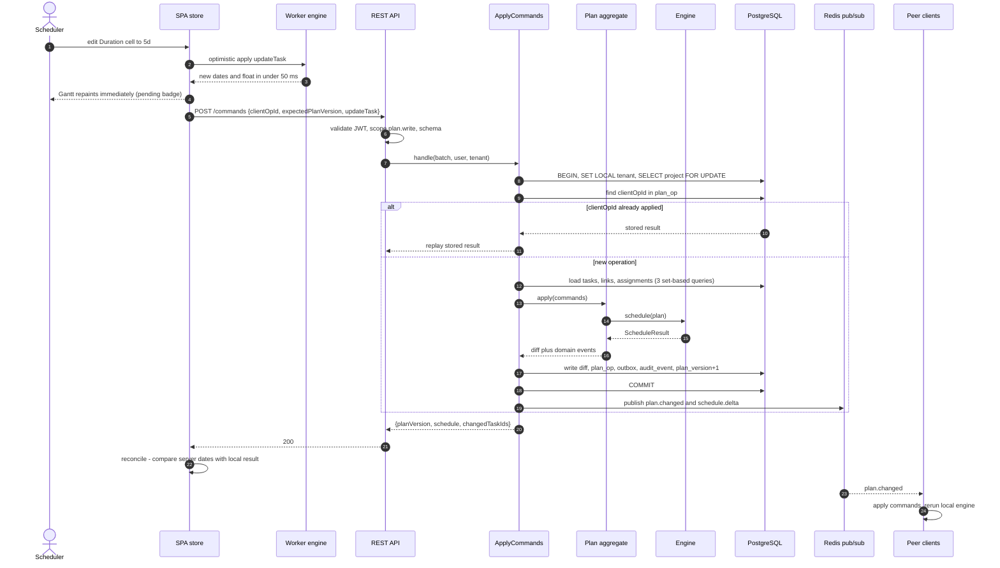
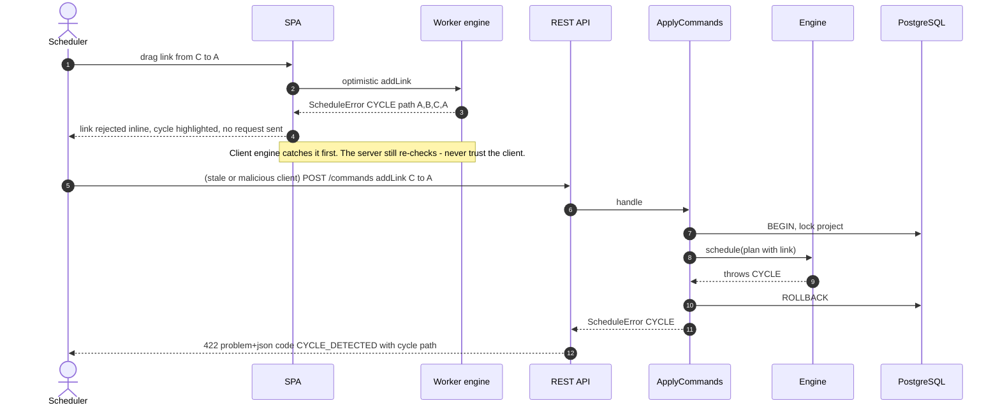
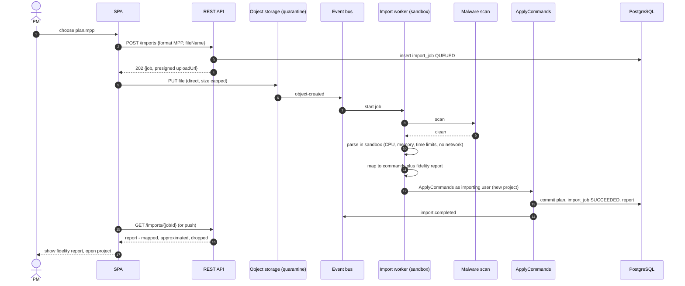
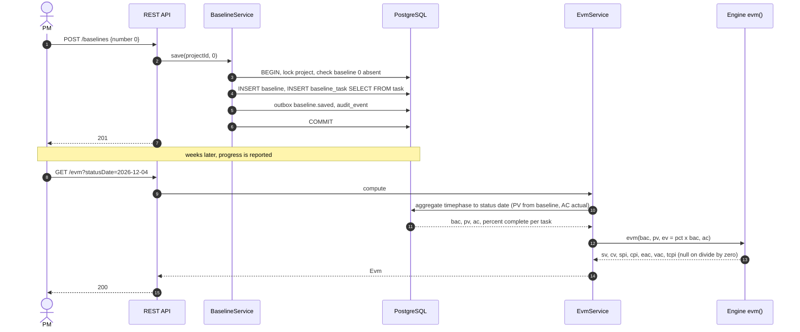
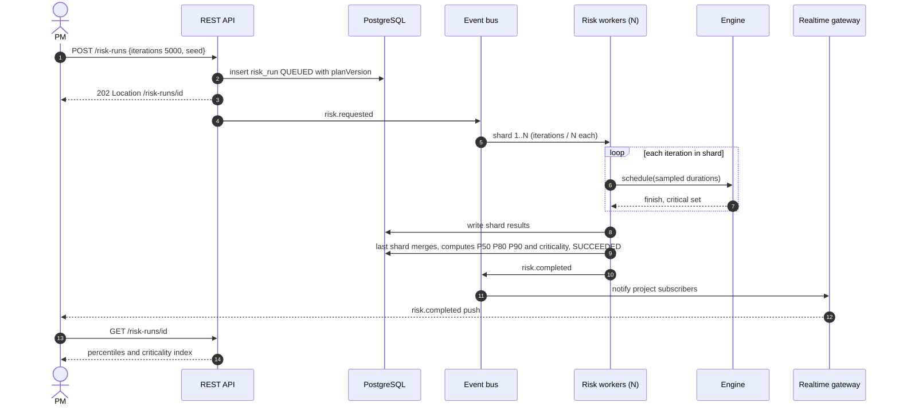
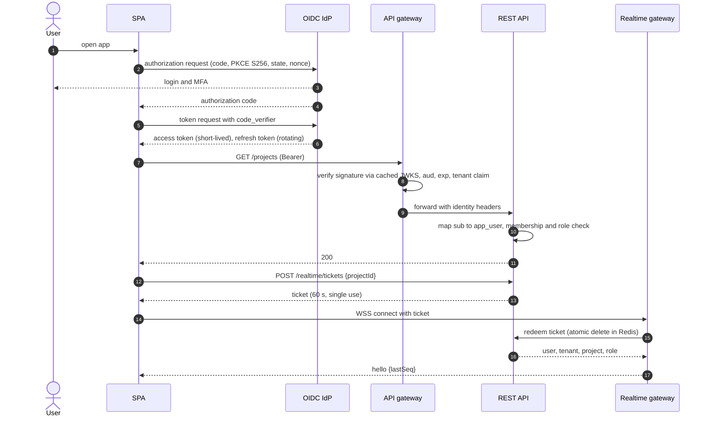
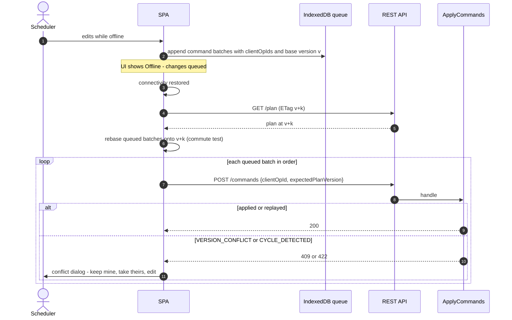

# 08 · Sequence Diagrams (request → domain → infrastructure)

Seven runtime scenarios. Participants map to the components in doc 04 §4. Each diagram is followed by *what to notice*.

## SD-1 · Edit a task duration (the hot path)

**Notice.** (1) The user never waits for the network: the worker engine answers first. (2) The server result is authoritative; comparing it with the optimistic one is a **continuous consistency check** between the two engine hosts. (3) Everything that must be atomic — data, op log, outbox, audit — is in one `COMMIT`; the Redis publish is best-effort *after* commit.

## SD-2 · Add a link that would create a cycle

**Notice.** Rejection costs no write and leaves `planVersion` unchanged. The cycle path in the response lets any client highlight the offending chain.

## SD-3 · Import an MS-Project file (asynchronous, quarantined)

**Notice.** The API tier never parses the file. The importer runs with no network, read-only root filesystem, 1 CPU/1 GB, 60 s limit, and produces **commands** — the same validated write path as the UI, so an imported plan cannot violate invariants.

## SD-4 · Save a baseline and compute EVM

**Notice.** Baselines are a set-based `INSERT … SELECT` — O(1) round trips regardless of plan size. EV is derived from percent complete × BAC, **never** from actual cost.

## SD-5 · Monte Carlo risk run

**Notice.** Pinning the run to a `planVersion` + `seed` makes it reproducible and auditable. Per-tenant concurrency limits (bulkhead) stop one tenant starving others.

## SD-6 · Sign-in and WebSocket ticket (OIDC + PKCE)

**Notice.** Tokens are kept in memory (not localStorage) and renewed with rotating refresh tokens; the WebSocket never sees a bearer token in a URL.

## SD-7 · Offline edit and reconnect

**Notice.** `clientOpId` makes replay safe if the connection drops mid-request. A batch that no longer applies is never silently dropped — it is surfaced for a decision.
