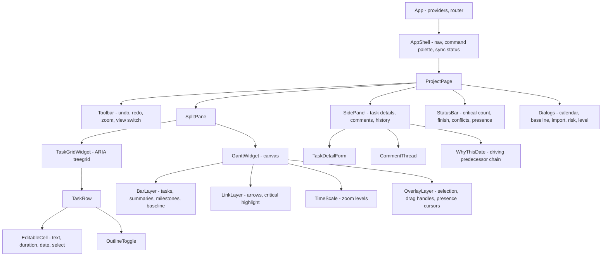
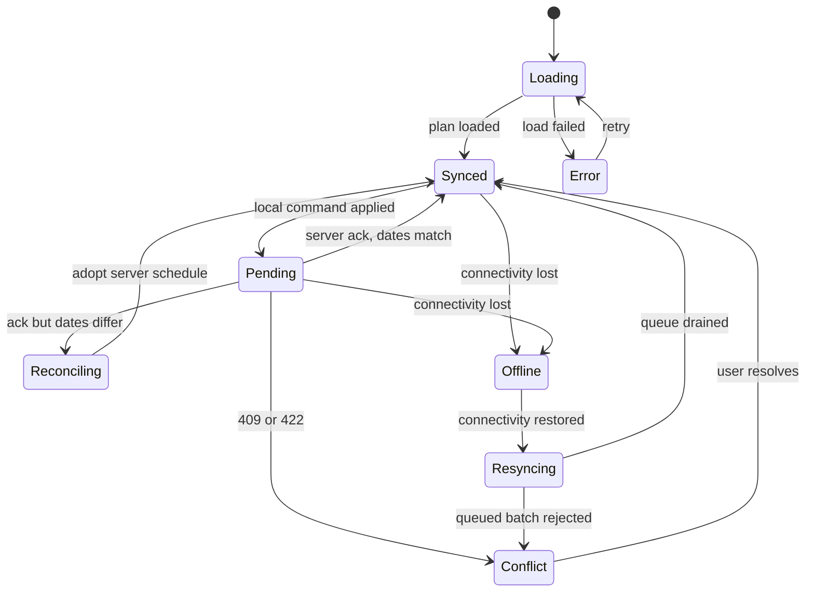
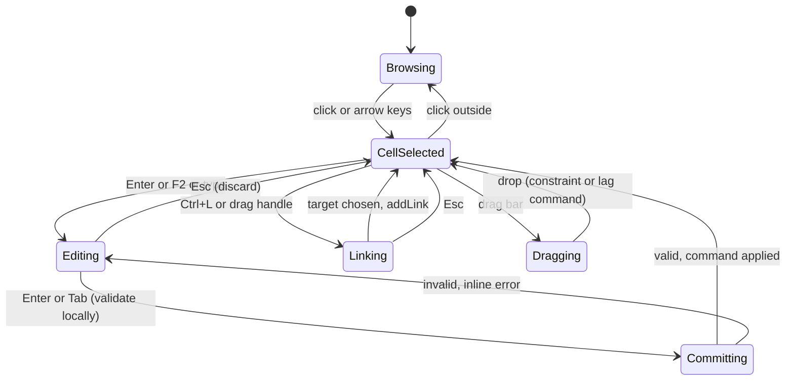
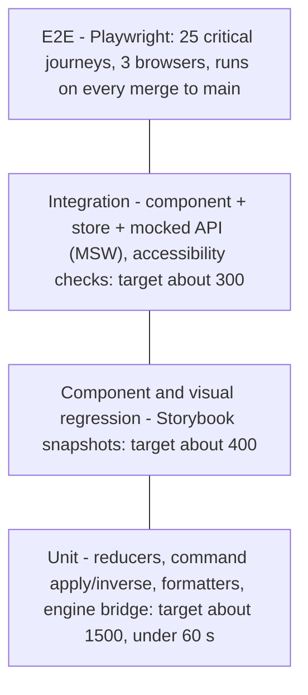

# 09 · Frontend and UX Design

Standards applied: component-driven (Feature-Sliced) architecture, explicit state boundaries and side-effect handling, Core Web Vitals budgets, WCAG 2.1 AA, XSS/CSRF-safe token handling, test pyramid.

## 1. Architecture — Feature-Sliced Design

```
src/
  app/        providers, router, auth bootstrap, global error boundary
  pages/      route-level compositions (ProjectPage, PortfolioPage, MyWorkPage, AdminPage)
  widgets/    GanttWidget, TaskGridWidget, NetworkWidget, ResourceHistogramWidget, ScenarioCompareWidget
  features/   edit-task, link-tasks, reorder-task, set-baseline, run-risk-sim, level-resources, import-plan, comment
  entities/   task, link, calendar, resource, project  (model + ui atoms + api)
  shared/     ui kit (Atomic: atoms/molecules), lib (engine client, time utils), config
```
Rule (enforced by `eslint-plugin-boundaries`): a layer may import only from layers *below* it; slices in the same layer do not import each other. This keeps features independently testable and deletable.

### 1.1 Component hierarchy



**Notes.** The grid and the Gantt share **one scroll model and one row model** (virtualised: only visible rows are rendered), which is what makes 50 k rows feasible. The Gantt is drawn on `<canvas>` (DOM bars would exceed 100 k nodes) with an **accessible mirror**: the treegrid carries all information and keyboard operation; the canvas is `aria-hidden` and purely a visual projection of the same data.

## 2. State management — explicit boundaries

| State kind | Where it lives | Mutated by | Notes |
|---|---|---|---|
| **Server state** (project list, resources, audit) | TanStack Query cache | queries/mutations | Stale-while-revalidate; keys include tenant + project |
| **Plan state** (tasks, links, calendars, schedule) | Normalised store (`byId` maps + ordered ids), owned by the **Plan module** | *Only* by applying commands | Single reducer: `apply(command) → {state, inverse}`; engine in Web Worker recomputes schedule |
| **Sync state** | Finite-state machine (below) | network events | Drives the status chip |
| **UI state** (selection, zoom, expanded rows, column widths) | Zustand slices | UI events | Persisted per-user in `localStorage` (non-sensitive) |
| **Form drafts** | Component-local | – | Committed as a command on blur/enter |

**Side effects** are isolated in three places only: the *API client* (HTTP), the *realtime client* (WebSocket) and the *engine worker bridge*. Components never call `fetch` or `postMessage`. This makes the UI deterministic under test: feed it commands and server events, assert on the render.

### 2.1 Sync state machine



### 2.2 Editing interaction flow



## 3. Performance budget and techniques

| Metric | Budget | Technique |
|---|---|---|
| LCP | ≤ 2.5 s (p75, 4G) | Route-level code splitting; Gantt/engine worker lazy-loaded after shell; preload fonts; CDN |
| INP | ≤ 200 ms | Engine in a Web Worker; commands applied in micro-batches; no layout thrash in grid |
| CLS | ≤ 0.1 | Reserved sizes for toolbar/status; skeleton rows |
| Gantt scroll | ≥ 55 fps at 50 k rows | Row virtualisation, canvas layers with dirty-rect redraw, `OffscreenCanvas` for bars |
| Initial JS | ≤ 180 KB gz (shell) + ≤ 250 KB gz (project route) | Tree-shaking, no moment/lodash-full, `import()` for dialogs |
| Plan load | 10 k tasks < 1 s after TTFB | NDJSON streaming parse in worker, `structuredClone`-free transfer using transferable buffers |
| Memory | ≤ 150 MB for 50 k tasks | Struct-of-arrays typed arrays for dates; strings interned |

Budgets are enforced by Lighthouse-CI and bundle-size checks in the pipeline; a regression > 10 % fails the PR.

## 4. Accessibility (WCAG 2.1 AA)

| Area | Design |
|---|---|
| Grid semantics | `role="treegrid"`, `aria-rowcount`, `aria-level`, `aria-expanded`, `aria-selected`; roving `tabindex` |
| Keyboard | Full operation without a mouse: arrows, Enter/F2 edit, Tab commit, `Ctrl+]` indent, `Alt+↑/↓` reorder, `Ctrl+L` link, `Ctrl+Z/Y` undo/redo, `/` command palette; all shortcuts listed and remappable |
| Gantt alternative | Everything the canvas shows is available in the grid and the *Why this date* panel; critical path is also a column and a filter, not colour-only |
| Colour & contrast | Text ≥ 4.5:1, graphical objects ≥ 3:1; critical/near-critical distinguished by **pattern + label**, never colour alone; dark and high-contrast themes |
| Live regions | `aria-live="polite"` announces "Finish moved +2 days, 3 tasks became critical" after each edit |
| Focus | Visible focus ring, focus trapped in dialogs and restored on close, no focus loss on virtualised row recycling |
| Motion | Respect `prefers-reduced-motion` |
| Targets | ≥ 24×24 px pointer targets; drag operations have keyboard equivalents |
| Testing | `axe-core` in component tests and e2e; manual screen-reader pass (NVDA, VoiceOver) per release |

## 5. Security (frontend)
* **XSS:** React escapes by default; no `dangerouslySetInnerHTML` (lint-banned). User text (task names, comments) rendered as text; rich comments use a sanitised Markdown subset (DOMPurify allow-list). Strict **CSP**: `default-src 'self'; script-src 'self'; object-src 'none'; frame-ancestors 'none'; base-uri 'none'` with nonces, plus Trusted Types.
* **CSRF:** API uses `Authorization: Bearer` (not cookies) ⇒ no ambient credentials to forge. If the optional BFF (cookie session) deployment is used, cookies are `HttpOnly; Secure; SameSite=Lax` and mutating calls require a double-submit CSRF header.
* **Token handling:** access token in memory only; refresh via rotating refresh token (silent iframe-less flow); nothing sensitive in `localStorage`/`IndexedDB` except the *plan cache*, which is encrypted per session with a WebCrypto key held in memory and purged on sign-out.
* **Imports/exports:** file names sanitised; downloads served with `Content-Disposition: attachment` and `X-Content-Type-Options: nosniff`.
* **Dependencies:** lockfile, `npm audit`/OSV scan, SRI on any third-party script (target: none).

## 6. Frontend test pyramid



| Level | Scope | Tooling | Gate |
|---|---|---|---|
| Unit (base) | Pure functions: command reducer + inverse, date/duration formatting, fractional index, conflict rebase | Vitest | ≥ 90 % branches in `entities/*/model` |
| Component / visual | Atoms, molecules, grid cells in every state | Storybook + test-runner | Zero axe violations |
| Integration | A feature with real store, real engine (worker shim) and mocked network | Vitest + Testing Library + MSW | Every feature has ≥ 1 |
| Contract | SPA ↔ API | Pact | Provider verification in API pipeline |
| E2E (tip) | Create plan → link → critical path; offline/reconnect; import; baseline; risk run | Playwright | Median flake rate < 1 % |
| Non-functional | Performance (Lighthouse-CI, scroll trace), a11y (axe + manual), security (CSP check) | – | Budgets above |

## 7. Key screens (information design)
1. **Project workspace** — grid + Gantt + side panel; status bar shows finish date, critical task count, conflict count, sync state, collaborators.
2. **Why this date** — click any date: shows the driving predecessor chain, constraint or calendar that sets it, and the slack to the next constraint.
3. **Scenario compare** — side-by-side finish/cost/critical-path diff of a what-if against live.
4. **Resource load** — heat-map + histogram across projects; one-click levelling dry-run with a preview of finish-date impact.
5. **Risk** — S-curve of finish-date probability, tornado chart of criticality index.
6. **Import fidelity report** — three-column list: mapped / approximated / dropped, each with a "fix" link.
7. **My work** — a mobile-first list of the user's tasks with big-target progress controls.
