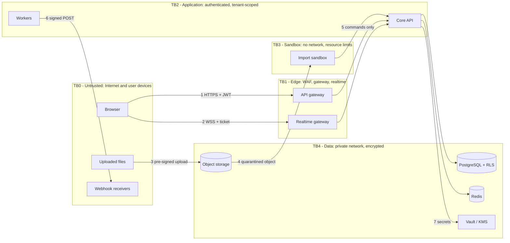

# 10 · Security Architecture and Threat Model

Security is a first-class driver because the legacy product's two biggest risks were *Java-native deserialization of user files* (D-04) and *dynamic code in formulas* (D-10). The design removes both by construction. Standards applied: Zero Trust, least privilege, OAuth2/OIDC, RBAC with audit trails, secrets in a vault, AES-256 at rest, TLS 1.2+ in transit, OWASP Top 10 and ASVS L2 as the verification baseline.

## 1. Data-flow diagram and trust boundaries

## 2. Assets and data classification

| Class | Examples | Controls |
|---|---|---|
| **Restricted** | OIDC client secrets, webhook secrets, KMS keys, audit hash anchors | Vault only; never logged; rotation ≤ 90 days |
| **Confidential** | Plan content, rates/costs, comments, resource names & rates | Tenant isolation (RLS), RBAC, encryption at rest (AES-256), field-level cost visibility, no copies in logs |
| **Internal** | Metrics, traces (IDs only), config | Access via platform roles |
| **Public** | API docs, status page | – |

Personal data in scope: user name/email, resource names, comments. Minimised: no passwords, no government IDs, no free-form PII fields by default; support export/erase (FR-GV-03).

## 3. STRIDE analysis

| # | Element | Threat | Category | Mitigation | Residual |
|---|---|---|:-:|---|:-:|
| T1 | Gateway | Forged/expired JWT | S | Signature + `iss/aud/exp/nbf` check, JWKS cached with kid rollover, clock-skew ≤ 60 s | L |
| T2 | API | Access to another tenant's plan by guessing UUIDs | I/E | RLS on every table (tested), tenant claim bound to session, `404` for foreign ids, UUIDs unguessable | L |
| T3 | API | Privilege escalation (viewer issues commands) | E | RBAC check in the *application layer* per command, not only per route; deny-by-default; matrix tested (§4) | L |
| T4 | Command endpoint | Mass assignment / tampering with derived fields (`es`, `is_critical`, `plan_version`) | T | Zod schemas `strict()`; schedule outputs are read-only and engine-written | L |
| T5 | Command endpoint | Replay of a captured request | R/T | `clientOpId` idempotency; short-lived tokens; TLS | L |
| T6 | DB | SQL injection | T | Parameterised queries only (driver placeholders), no string-built SQL, `semgrep` rule, least-privilege DB role without DDL | L |
| T7 | Import | Malicious file: parser exploit, zip/XML bomb, XXE | T/D/E | Sandbox (§5), XML parser with DTD/external entities **disabled**, size/entry/depth limits, no native deserialization, fuzzing | M |
| T8 | Formula engine | Code execution via custom-field formula | E | Non-Turing-complete grammar, AST interpreter with step/depth limits, no host eval | L |
| T9 | Webhooks | SSRF to internal metadata services | I | HTTPS only, DNS resolved and IP checked against private/link-local ranges at *delivery* time (anti-rebinding), no redirects, egress proxy allow-list | L |
| T10 | Realtime | Subscribing to another project's stream | I | Single-use bound ticket; membership re-checked on subscribe and on role change (server pushes `4403` close) | L |
| T11 | Realtime | Connection flood / slowloris | D | Per-IP and per-tenant connection caps, send-buffer caps, idle timeouts | M |
| T12 | Risk worker | Resource exhaustion (100 k iterations × huge plan) | D | Quota per tenant (iterations × tasks), queue priorities, timeouts, per-tenant concurrency bulkhead | L |
| T13 | Audit log | Tampering to hide actions | T/R | Append-only trigger, hash chain, head hash anchored to WORM object storage hourly, DB role has no UPDATE/DELETE | L |
| T14 | Browser | XSS via task name/comment | T/I | Text-only rendering, DOMPurify allow-list, strict CSP + Trusted Types | L |
| T15 | Browser | Token theft | I | Tokens in memory only, short TTL, rotating refresh, no tokens in URLs, `Referrer-Policy: no-referrer` | M |
| T16 | Supply chain | Malicious dependency / build | T | Lockfile + provenance (SLSA L3 target), SBOM (CycloneDX), signed images (cosign), admission policy verifies signatures, OSV scan | M |
| T17 | Secrets | Leak via logs/config | I | Vault + external-secrets, secret scanning in CI, log redaction filter (`authorization`, `secret`, `token`) | L |
| T18 | Insider | Admin abuses access | R/E | Break-glass access, 4-eyes for data export, all admin actions in audit, JIT elevated roles | M |
| T19 | LLM features | Prompt injection via imported task text; data exfiltration | I/T | See doc 11 §B5: untrusted text is *data*, no tool access, output is a proposal needing human acceptance, redaction before egress | M |
| T20 | Multi-tenant noise | One tenant degrades others | D | Rate limits, bulkheads, per-tenant statement timeouts, connection pool partitioning | L |

L/M/H = residual risk after mitigation (target: no H at GA).

## 4. Authorisation model (RBAC + project membership)

Roles: **ORG_ADMIN, PORTFOLIO_MANAGER, PROJECT_MANAGER, SCHEDULER, TEAM_MEMBER, VIEWER**. Effective permission = *role in the project* (from `project_member`) ∩ *scope in the token* ∩ *tenant policy*.

| Action | Org Admin | Portfolio Mgr | Project Mgr | Scheduler | Team Member | Viewer |
|---|:-:|:-:|:-:|:-:|:-:|:-:|
| Read plan | ✔ | ✔ | ✔ | ✔ | ✔ | ✔ |
| See rates / costs | ✔ | ✔ | ✔ | ✘ | ✘ | ✘ |
| Edit structure, links, constraints | ✔ | ✘ | ✔ | ✔ | ✘ | ✘ |
| Update own task progress | ✔ | ✘ | ✔ | ✔ | ✔ (assigned only) | ✘ |
| Save baseline | ✔ | ✘ | ✔ | ✘ | ✘ | ✘ |
| Run risk / levelling | ✔ | ✘ | ✔ | ✔ | ✘ | ✘ |
| Import / export | ✔ | ✔ | ✔ | ✔ (export) | ✘ | ✘ |
| Manage members / webhooks | ✔ | ✘ | ✔ (members) | ✘ | ✘ | ✘ |
| Read audit trail | ✔ | ✘ | ✘ | ✘ | ✘ | ✘ |

The matrix is a **data-driven test table**: 6 roles × ~40 actions executed against the API in CI; any cell not explicitly allowed must return `403`. Field-level rule: responses for roles without cost permission omit `cost`, `rate`, `evm` fields (not just hide them in the UI).

## 5. Untrusted-file pipeline (hardened)

1. Upload goes **directly** to a *quarantine* bucket via pre-signed URL (size ≤ 50 MB, content-type allow-list, key = random UUID). The API never touches the bytes.
2. Object-created event → malware scan → import worker in a **sandbox**: distroless image, non-root, read-only root FS, no network, seccomp + gVisor/Kata runtime, 1 vCPU / 1 GB / 60 s, `ulimit` on processes and files.
3. Parsers: MSPDI (XML) with DTD and external entities disabled and entity-expansion limits; ZIP-based formats with entry-count, ratio and path-traversal checks; MPP via the isolated converter (MPXJ, a separate LGPL component in its own container); **legacy `.pod` (Java serialization) is never deserialized with Java’s native mechanism** — a purpose-built reader parses the documented stream grammar and rejects unknown classes (allow-list) — or the format is declined (`IMPORT_REJECTED_UNSAFE`) until that reader passes fuzzing.
4. Output is **commands**, applied through the standard validated path as the importing user (no privilege amplification).
5. Every import yields a fidelity report; parser crashes/timeouts produce `FAILED` jobs, never partial plans.

## 6. Cryptography and secrets

| Purpose | Mechanism |
|---|---|
| Transport | TLS 1.2+ (1.3 preferred), HSTS, modern cipher suites; mTLS between pods via service mesh (Zero Trust) |
| At rest | Storage-level AES-256 (KMS-managed keys); selected columns (webhook secret refs, tokens) never stored — only vault references |
| Hashing | SHA-256 for the audit chain; **Argon2id** for any locally stored credential (API keys are stored as Argon2id hashes; shown once) |
| Signatures | HMAC-SHA256 for webhooks (constant-time compare, timestamp window) |
| Randomness | CSPRNG only (`crypto.randomUUID`, `crypto.getRandomValues`) |
| Secrets | Cloud/Vault secret store → External Secrets → pod env/file; no secrets in images, repos or Helm values; rotation runbook (doc 12) |

## 7. Audit trail
Event schema in `audit_event`. Logged: authentication, every applied command batch (summary + op `seq`), role/membership changes, imports/exports, baseline saves, webhook changes, admin and break-glass actions, failed authorisation. Hash chain: `hash = SHA256(prev_hash ‖ canonical_json(row))`. Verification endpoint/CLI recomputes the chain and compares with the anchored head; any break pinpoints the first tampered row. Retention per tenant policy (default 7 years).

## 8. Secure SDLC checklist (gates in CI)

| Control | Tooling | Gate |
|---|---|---|
| Input validation on every boundary | Zod strict schemas; fuzz via Schemathesis | PR |
| Parameterised queries | semgrep rule bans string-concatenated SQL | PR |
| AuthN/Z | per-route + per-command checks; authz matrix test | PR |
| Secrets | gitleaks, vault-only config | PR |
| Dependencies | npm audit / OSV, license check (no GPL in distributed core) | PR |
| SAST / IaC | CodeQL/semgrep, Checkov/tfsec, Kyverno policy tests | PR |
| Container | Trivy, distroless base, non-root, read-only FS | Build |
| SBOM + provenance + signing | CycloneDX, SLSA provenance, cosign | Release |
| DAST | OWASP ZAP baseline against staging | Nightly |
| Pen test | External, before GA and yearly | Release |
| Threat model review | This document, reviewed at each epic that adds a boundary | Epic |

## 9. Compliance alignment (indicative)
Mapped to **ISO/IEC 27001:2022 Annex A** themes — A.5 organisational (policies, supplier mgmt, secure development), A.6 people, A.7 physical (cloud provider inherited), **A.8 technological** (access control 8.2–8.5, cryptography 8.24, secure development 8.25–8.29, logging 8.15, backup 8.13, network security 8.20–8.22). A control-to-evidence matrix is produced in R1; SOC 2 / sector-specific regulatory mappings (e.g. banking technology directives) are tenant-driven overlays, not baked into the product.
