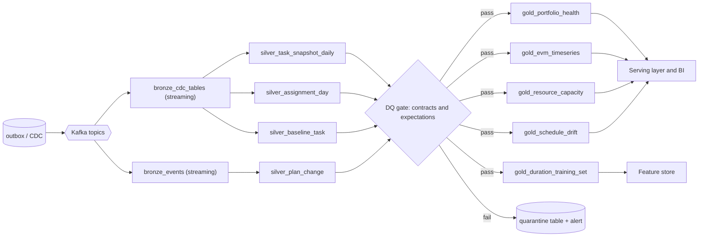
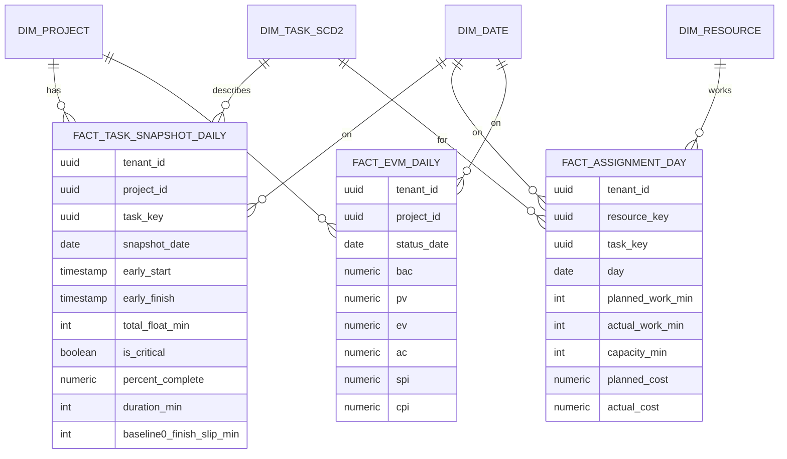
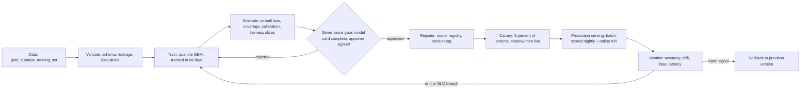

# 11 · Data Platform, Analytics and AI/MLOps

Two concerns share this document because the AI features are *consumers* of the analytics platform: the historical-actuals dataset that trains the duration model is the same Silver layer that feeds portfolio dashboards.

# Part A — Data engineering

## A1. Architecture (medallion, Kappa-style)
We use a **Kappa** pattern: the event log is the single source of truth and every analytical table is a re-playable projection. Batch is just replay. (Lambda's dual code paths are rejected: they create two implementations of every metric.)

| Layer | Content | Storage | Latency | Retention |
|---|---|---|---|---|
| **Bronze** | Raw outbox events (`plan.changed`, `baseline.saved`, …) and CDC of `task`, `assignment_timephase`, `baseline_task`; append-only, schema-on-read, `_ingested_at` | Object storage, Parquet/Iceberg, partitioned by `tenant_id/event_date` | ≤ 1 min | 7 y |
| **Silver** | Conformed, de-duplicated, typed: `dim_project`, `dim_task_scd2`, `dim_resource`, `fact_task_snapshot_daily`, `fact_assignment_day`, `fact_baseline_task`, `fact_plan_change` | Iceberg tables | ≤ 15 min | 7 y |
| **Gold** | Business marts: `mart_portfolio_health`, `mart_evm_timeseries`, `mart_resource_capacity`, `mart_schedule_drift`, `ml_duration_training_set` | Iceberg + serving cache (Postgres/ClickHouse) | ≤ 15 min | 3 y |

### Pipeline DAG

Orchestration: Dagster (asset-based, so lineage and freshness are first-class); streaming jobs on Flink/Spark Structured Streaming.

## A2. Logical data model (Gold star schema)

**Physical notes.** Iceberg partitioning: `(tenant_id bucket(16), days(snapshot_date))`; sort by `project_id`; Z-order on `(tenant_id, project_id)` for dashboard queries; `dim_task_scd2` keeps history (`valid_from/valid_to/is_current`) so that renames/re-parenting do not rewrite facts. Dashboard marts are materialised nightly *and* incrementally; the serving store holds the last 24 months only (cost-aware: older data queried in the lake).

## A3. Data quality and contracts
Each Silver/Gold asset has a **data contract** (schema, semantics, owner, freshness SLA) and executable expectations (Great Expectations/Soda):

| Rule | Asset | Action on failure |
|---|---|---|
| Schema enforcement: unknown column or type change in Bronze | all | Route to quarantine, page data owner |
| `tenant_id` non-null and valid | all | Quarantine row |
| `percent_complete ∈ [0,1]`, `duration_min ≥ 0` | task snapshot | Quarantine row |
| `Σ assignment_day.planned_work_min` = `assignment.work_min` (±0) | assignment day | Block Gold publish |
| `ev = percent_complete × bac` (±0.01) | EVM | Block Gold publish — *regression guard for legacy defect D-01* |
| Uniqueness `(project_id, task_key, snapshot_date)` | snapshot | Dedup then alert if > 0.1 % |
| Freshness | Gold marts | Alert if lag > SLA |
| Row-count drift vs 7-day median ±40 % | all | Warn |

**SLAs/SLOs:** Bronze lag ≤ 1 min (p95); Silver ≤ 15 min; Gold marts ≤ 15 min; DQ pass rate ≥ 99.5 % rows; dashboard query p95 ≤ 2 s.

## A4. Lineage and governance
* OpenLineage events emitted by Dagster/Spark → Marquez/DataHub: source-to-consumption lineage from `outbox.event_type` → Bronze → Silver → Gold → dashboard tile.
* **Classification & masking:** columns tagged (Restricted/Confidential/Internal). *Confidential* cost/rate columns are masked (`NULL`) in views for roles without cost permission; resource names pseudonymised in the ML training set (`resource_key` = salted hash). Row-level security mirrors tenant isolation in the serving store.
* **Encryption:** object storage SSE-KMS per tenant-group key; column-level encryption not required given classification, revisit for regulated tenants.
* **Right-to-erase:** tenant erase = delete tenant partitions (Iceberg `DELETE` + snapshot expiry); user erase = pseudonymisation in dimensions.

## A5. Cost-aware querying
Partition-pruning enforced by a query linter (rejects queries on facts without a `tenant_id` and date predicate); result caching for dashboards; compaction jobs nightly; cold data to infrequent-access tier after 12 months; per-tenant cost attribution via `tenant_id` tags on compute jobs (FinOps, doc 12).

---

# Part B — AI / MLOps

## B1. Use-cases and guardrails

| ID | Feature | Technique | Output | Guardrail |
|---|---|---|---|---|
| AI-1 | **Duration suggestion** | Quantile gradient-boosted trees (P10/P50/P90) on historical actuals | Three-point estimate pre-filled as a *suggestion* | User accepts/edits; never auto-applied |
| AI-2 | **Schedule risk** | *Not ML*: Monte Carlo (doc 06 §9) | P50/P80/P90, criticality index | Deterministic, reproducible |
| AI-3 | **Plan-drift alert** | Anomaly detection on `gold_schedule_drift` | “This project's slip rate is 2.3σ above comparable projects” | Advisory only |
| AI-4 | **Plan draft from text** | LLM (optional, tenant opt-in) | Proposed command batch shown as a diff | Human approves; engine validates; prompt-injection defences (B5) |

## B2. Model lifecycle

## B3. Model card — Duration Suggestion v1 (template filled with design intent)

| Field | Content |
|---|---|
| **Model** | `duration-quantile-gbm`, v1.0 (design; not trained — no data exists yet) |
| **Intended use** | Suggest three-point duration estimates for new tasks from the tenant's own history of similar tasks. Decision support only. |
| **Out of scope** | Evaluating people; staffing or performance decisions; cross-tenant benchmarking without opt-in |
| **Training data** | Completed tasks (`actual_finish` present) with ≥ 3 prior similar tasks per tenant; features in B4; excludes tasks with manual-override durations flagged as placeholders |
| **Cold start** | < 200 completed tasks per tenant → fall back to a global prior trained on opt-in, anonymised aggregates; otherwise no suggestion |
| **Metrics** | Pinball loss at τ = 0.1/0.5/0.9; **coverage** of the P10–P90 interval (target 80 % ± 5); MAPE on P50; calibration curve |
| **Fairness / slices** | Metrics reported by project type, task size bucket, team and region; no individual-level features; resource identity is pseudonymised and excluded from the feature set (prevents “this person is slow” inference) |
| **Explainability** | SHAP values per suggestion (top-3 drivers shown: e.g. “similar tasks took median 6.5 d; task name contains *migration*; assigned team load high”); global SHAP summary in the registry |
| **Limitations** | Text features are tenant-language dependent; unusual tasks yield wide intervals; assumes estimation practice stays stable |
| **Risks & mitigations** | Anchoring bias → show the interval, not a single number; feedback loop (accepted suggestions become training data) → track *suggested vs. accepted vs. actual* and down-weight accepted-unchanged labels |
| **Approvals** | Data owner · Security · Model risk reviewer · Product owner; re-approval on retrain with new features |
| **Review cadence** | Quarterly or on drift trigger |

## B4. Feature store schema (entity: `task`)

| Feature | Type | Source | Freshness | Notes |
|---|---|---|---|---|
| `name_embedding` | float[64] | task name via tenant-local text encoder | on change | PII-scrubbed |
| `name_tokens_hash` | int[] | hashed word n-grams | on change | |
| `parent_depth`, `sibling_count` | int | WBS | on change | |
| `n_predecessors`, `n_successors` | int | links | on change | |
| `assigned_units_sum` | float | assignments | daily | |
| `team_load_ratio` | float | `fact_assignment_day` | daily | planned / capacity over the task window |
| `calendar_work_min_per_day` | int | calendar | on change | |
| `project_type` | category | project metadata | static | |
| `similar_median_duration`, `similar_p90_duration`, `similar_count` | float, float, int | Silver: nearest 20 completed tasks by embedding | daily | leakage-guarded: only tasks finished **before** the task's creation |
| **label** `actual_duration_min` | int | `fact_task_snapshot_daily` | on completion | |

Feature definitions are versioned code (Feast); the online store (Redis) serves the same definitions as the offline Iceberg tables, guaranteeing training/serving parity. A **point-in-time-correct** join prevents leakage.

## B5. Security of AI features
* **Prompt-injection defence (AI-4):** imported/user text is passed to the model strictly as *data* inside a delimited block; the model has **no tools, no network, no memory across tenants**; its only output is a JSON command batch validated against the command schema and the engine; anything else is discarded. Task text that looks like instructions cannot trigger actions because nothing the model emits is executed without user approval.
* **Data egress:** redaction of emails/phones/IDs/rates before any external call; tenant opt-in; EU/US endpoint selection by data region; no provider-side training on tenant data (contractual + API flag).
* **Model access control:** inference API requires scope `ai.suggest`; model registry write access limited to the ML role; signed model artifacts verified at load.
* **Abuse:** per-tenant token and rate budgets; circuit breaker on the provider; deterministic fallbacks (feature simply hides).

## B6. Monitoring
| Signal | Metric | Alert |
|---|---|---|
| **Accuracy** | rolling coverage of P10–P90 (target 80 %), pinball loss, MAPE on completed tasks | coverage < 70 % or > 90 % for 7 days |
| **Data drift** | PSI per feature (> 0.2 warn, > 0.3 page), KS test on `duration_min` distribution | threshold crossing |
| **Concept drift** | residual mean/variance shift (CUSUM) | trigger retrain |
| **Bias** | coverage and error gaps across slices (project type, size, region) | gap > 10 pts |
| **Usage** | suggestion shown/accepted/edited rates; acceptance-then-large-miss rate | informational / product review |
| **Ops** | online latency p95 < 150 ms, error rate, fallback rate | SLO burn |

**Dashboard spec (Grafana):** row 1 coverage & MAPE trend by model version · row 2 PSI heat-map by feature · row 3 slice fairness bars · row 4 acceptance funnel · row 5 latency/errors/fallbacks · row 6 canary vs. stable comparison.

## B7. Governance workflow
Proposal → data-protection impact assessment → model card draft → offline evaluation → **approval gate** (four roles above) → canary → full release → quarterly review. Every model version, dataset snapshot hash, code commit and approver is recorded in the registry; an audit query can reproduce “which model suggested this value, trained on what, approved by whom”.
