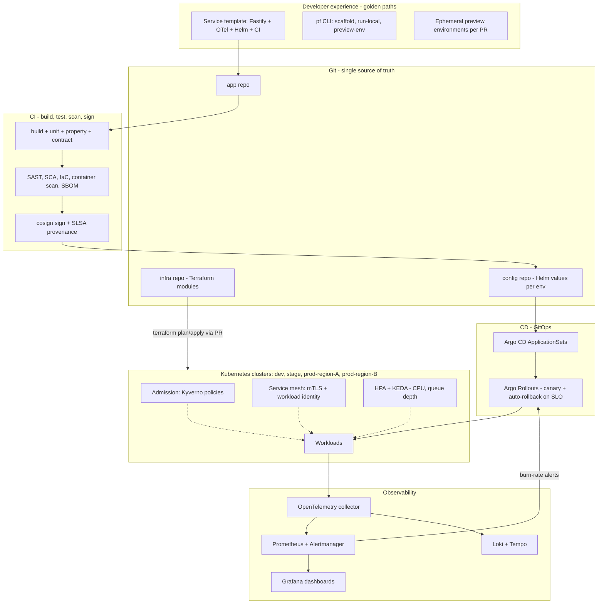

# 12 · Platform Engineering and Operations

Standards applied: Kubernetes-first, GitOps, Infrastructure-as-Code, SLOs with error budgets, chaos testing, Zero Trust (workload identity, mTLS, default-deny), policy-as-code, FinOps tagging, golden paths. Companion machine-readable files: `platform/slo.yaml` (OpenSLO), `platform/kyverno-policies.yaml`, `platform/networkpolicy.yaml`, `.github/workflows/ci.yml` — all four parse as valid YAML; the CI workflow's steps for engine tests, OpenAPI validation, schema execution and diagram rendering mirror what was run to build this pack.

## 1. Platform reference architecture

**Notes.** *Everything* reaches production through Git. Argo CD continuously reconciles clusters to Git; manual `kubectl` changes are reverted (drift correction) and alerted. Rollouts promote a canary only while SLO burn-rate stays below threshold — **the SLO is the release gate**, not a person's judgement at 5 p.m.

## 2. Environments
| Env | Purpose | Data | Scale |
|---|---|---|---|
| Preview (per PR) | Review & e2e | Synthetic seed | 1 replica, shared DB schema |
| Dev | Integration | Synthetic | minimal |
| Stage | Prod-like, load & DR drills | Anonymised corpus | 1/3 of prod |
| Prod (≥ 2 regions for HA tenants) | Customer traffic | Real | HPA |

## 3. CI/CD pipeline

```mermaid
%% name: cicd-pipeline
flowchart LR
  PR["Pull request"] --> L["Lint + type-check + boundary rules"]
  L --> UT["Unit + property tests: engine, domain"]
  UT --> CT["Contract: OpenAPI validate, Schemathesis, Pact"]
  CT --> DB["Schema: apply to Postgres, RLS tests, migration up/down"]
  DB --> SEC["Security: semgrep, gitleaks, OSV, Trivy, Checkov"]
  SEC --> IMG["Build image, SBOM, cosign sign"]
  IMG --> PE["Preview env + Playwright e2e + axe"]
  PE --> MRG{"Merge gate: all green + 1 approval"}
  MRG --> MAIN["main: promote to dev via config repo PR"]
  MAIN --> STG["stage: k6 load, DAST (ZAP), chaos smoke"]
  STG --> CAN["prod canary 5 percent, SLO watch 30 min"]
  CAN -->|"burn rate OK"| FULL["progressive rollout 25-50-100"]
  CAN -->|"burn rate breach"| RB["automatic rollback + incident"]
```

Quality gates (fail the pipeline): engine property tests; benchmark regression > 20 %; OpenAPI diff classified *breaking* without a version bump; any RLS/authz-matrix test failing; critical/high vulnerability without waiver; bundle-size budget; axe violations.

## 4. SLOs and error budgets

| SLI / SLO | Target | Window | Budget (30 d) | Source |
|---|---|---|---|---|
| API availability (non-5xx, excl. 429) | 99.9 % | 30 d rolling | 43 min | `platform/slo.yaml` |
| `POST /commands` < 300 ms | 95 % | 30 d | 5 % of requests | `platform/slo.yaml` |
| Realtime commit→peer < 250 ms | 95 % | 30 d | 5 % | `platform/slo.yaml` |
| Import job success (non-user-error) | 99 % | 30 d | 1 % | job metrics |
| Webhook first-attempt delivery | 98 % | 7 d | 2 % | dispatcher |
| Data freshness (Gold ≤ 15 min) | 99 % | 7 d | 1 % | Dagster freshness |

**Alerting** uses multi-window multi-burn-rate rules (Google SRE workbook): page when the 1 h *and* 5 min burn rate > 14.4 (2 % budget in 1 h); ticket when 6 h *and* 30 min burn > 6; informational at > 1 over 3 days. **Error-budget policy:** budget > 50 % left → ship normally; 25–50 % → only reliability and low-risk changes need extra review; < 25 % → feature freeze for the service until budget recovers; two budget exhaustions in a quarter → mandatory reliability epic.

## 5. Reliability engineering and chaos testing

| Experiment (Litmus/Chaos Mesh) | Hypothesis | Pass criteria |
|---|---|---|
| Kill 1 of 3 core pods under load | No failed commands; p95 < 400 ms | Zero 5xx beyond retries |
| Redis outage 5 min | Writes succeed; presence/cache off | `DEPENDENCY_UNAVAILABLE` only on realtime tickets; auto-recover |
| Kafka outage 10 min | Outbox accumulates; no data loss | Backlog drained < 5 min after recovery; no duplicates visible (idempotent consumers) |
| Postgres primary failover | RTO ≤ 2 min, RPO 0 for committed | Clients retry idempotently; no lost `plan_op` |
| 300 ms latency injected to DB | Circuit breaker + timeouts hold | No thread/event-loop starvation |
| Poison import file (zip bomb) | Sandbox contains it | Job `FAILED`, cluster unaffected |
| Realtime reconnect storm (10 k clients) | Gateway sheds presence first | Plan ops delivered, memory bounded |
| Region loss (quarterly DR drill) | RTO ≤ 1 h, RPO ≤ 5 min | Documented drill report |

Game days run quarterly in stage; selected experiments run continuously in prod at low blast radius.

## 6. Zero Trust, identity and policy
* **Workload identity:** pods authenticate to cloud APIs/vault with short-lived federated identities (OIDC projected service-account tokens), never static keys.
* **Network:** default-deny `NetworkPolicy` in every namespace plus explicit allows; the import sandbox namespace has **no ingress and no egress** (`platform/networkpolicy.yaml`); mTLS between services via the mesh; egress through a proxy with allow-list.
* **Policy-as-code:** Kyverno enforces signed images, non-root + read-only FS + dropped capabilities, and FinOps labels (`platform/kyverno-policies.yaml`); policies are unit-tested with `kyverno test` and versioned in Git.
* **Human access:** SSO + MFA, just-in-time elevation with expiry and approval, session recording for production shells, break-glass account with alerting.
* **Secrets:** External Secrets Operator syncs from the vault; rotation automated; no secrets in Helm values or images.

## 7. FinOps
| Practice | Implementation |
|---|---|
| **Tagging** | Mandatory labels `cost-center`, `team`, `environment`, `service` (admission-enforced) + cloud tags from Terraform modules; `tenant_id` tagged on batch/risk/analytics jobs |
| **Cost visibility** | OpenCost per namespace/service; per-tenant cost model = (CPU-s + GB-s of risk/import/analytics jobs) + storage + egress; weekly dashboard |
| **Optimisation** | HPA/KEDA right-sizing, spot nodes for risk/analytics workers (checkpointed), storage tiering, Redis/Kafka sizing reviews, Iceberg compaction |
| **Guardrails** | Budgets and anomaly alerts per environment; preview environments auto-expire in 24 h; per-tenant quotas on risk iterations |
| **Unit economics KPI** | *Cost per active editor per month* and *cost per 1 000 commands* tracked against gross margin targets |

## 8. Golden paths (paved roads)
1. `pf new service` → repo from template with Fastify, Zod, OpenTelemetry, health probes, Dockerfile (distroless), Helm chart, CI pipeline, SLO stub, runbook stub.
2. `pf preview` → ephemeral namespace with seeded DB.
3. `pf slo add` → generates OpenSLO + alert rules + dashboard panel.
4. Everything off the path (custom CI, hand-built images) requires an architecture exception recorded as an ADR.

## 9. SRE dashboards (specification)
| Dashboard | Panels |
|---|---|
| **Service health** | RED metrics per route (rate, errors, duration p50/p95/p99), SLO burn-down, error-budget remaining, saturation (CPU, event-loop lag, DB pool) |
| **Collaboration** | Active editors, WebSocket connections, fan-out latency, reconnect rate, `VERSION_CONFLICT` rate (an early signal of poor rebase) |
| **Engine** | Recalc duration p95 by plan-size bucket, incremental-vs-full ratio, client/server schedule mismatch counter (should be 0) |
| **Data & jobs** | Outbox lag, Kafka consumer lag, import/risk queue depth and age, webhook failure rate |
| **Tenant** | Per-tenant request share, cost, quota usage — noisy-neighbour detection |
| **Security** | AuthN failures, 403 rate, RLS-denied errors, WAF blocks, secret-access anomalies |

## 10. Backup and disaster recovery
* PostgreSQL: continuous WAL archiving + base backups, PITR 35 days; cross-region replica; **restore tested monthly** into stage and checked with the audit-chain verifier.
* Object storage: versioning + cross-region replication; WORM bucket for audit anchors.
* Kafka: replication factor 3, `min.insync.replicas=2`; topics can be rebuilt from the outbox if needed.
* Targets: RPO ≤ 5 min, RTO ≤ 1 h (NFR-DUR-01). Evidence: DR drill reports each quarter.

## 11. Runbooks

### RB-1 · Elevated `POST /commands` latency
1. **Check:** Service-health dashboard → is latency engine, DB or lock wait? Engine panel: recalc p95 by plan-size bucket.
2. **If a few huge plans dominate:** identify `project_id` from traces; confirm full-recalc path (incremental disabled?) → enable incremental flag for that tenant; advise batching.
3. **If DB lock wait:** `SELECT * FROM pg_stat_activity WHERE wait_event_type='Lock'` → find long `FOR UPDATE project` holders; terminate only if > 60 s and escalate.
4. **If CPU saturated:** scale core-api (HPA max), verify canary not stuck.
5. **Communicate:** status page "degraded performance"; open incident if SLO burn > 6.

### RB-2 · Realtime gateway connection storm
1. Symptoms: connection count spike, memory climb, `4408` closes.
2. Enable presence shedding (`RT_SHED_PRESENCE=true` via flag); lower per-tenant connection cap.
3. Scale gateway replicas; check upstream Redis latency.
4. After recovery, confirm clients re-synced (gap-detection counter returns to baseline).

### RB-3 · Postgres failover
1. Confirm automatic promotion completed; check replication lag of replicas.
2. Verify app reconnects (pool recycle) and `plan_version` continuity: `SELECT max(seq) FROM plan_op GROUP BY project_id` vs. outbox.
3. Run the audit-chain verifier on the last hour of events.
4. Post-incident: rebuild old primary as replica; review RPO evidence.

### RB-4 · Secret / key rotation
1. Create new secret version in vault; External Secrets syncs.
2. Rolling restart with `maxUnavailable: 0`; verify health.
3. Revoke the old version after 24 h; record in audit.

### RB-5 · Tenant data export / erase
1. Verify the requester and legal basis (ticket); 4-eyes approval.
2. Export: job produces `.plan` + CSV bundle to a time-limited, encrypted link.
3. Erase: soft-delete → 30-day hold → hard delete incl. Iceberg partitions → certificate of erasure.
