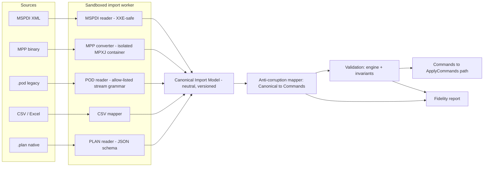
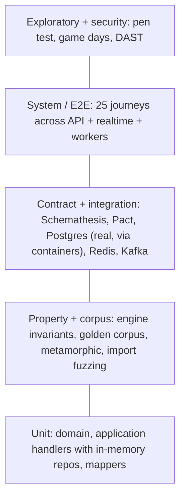

# 13 · Migration, Compatibility and Verification Strategy

"Superior" is only credible if users can **bring their plans with them** and we can **prove the new engine agrees with the old one where it should**. This document specifies (1) importers/exporters and the fidelity report, (2) the black-box *golden corpus* that serves as the behavioural oracle, (3) the deviation catalogue, and (4) the overall test strategy.

## 1. Import / export architecture

**Design rules.**
1. Parsers are **dumb**: they produce the Canonical Import Model (CIM) and nothing else. They never call domain code.
2. The anti-corruption mapper turns CIM into **commands**, so imports obey exactly the same invariants as UI edits.
3. Every field is classified in the report: **mapped** (exact), **approximated** (semantically close, with note), **dropped** (with reason). Nothing is lost silently.
4. Exports are produced from the same canonical model: `.plan` (lossless), MSPDI (best-effort), CSV, iCal, PDF.
5. MPP support is provided by **MPXJ** run as a separate container (LGPL kept at arm's length; replaceable). If MPXJ cannot read a file version, the user is told to export MSPDI from the source product.

## 2. Field mapping (MSPDI ↔ PlanForge; legacy ids preserved)

| Concept | MSPDI / legacy value | PlanForge | Fidelity |
|---|---|---|---|
| Dependency type | FF=0, FS=1, SF=2, SS=3 (MSPDI `Type`) | `FS/SS/FF/SF` enum | mapped |
| Lag | `LinkLag` in tenths of a minute (MSPDI) | `lagMin` integer minutes | mapped (÷10) |
| Constraint type | 0 ASAP … 7 FNLT (ids equal MPX) | `ConstraintType` | mapped |
| Duration | ISO-8601 `PTnHnMnS` | `durationMin` using the task calendar's minutes/day | mapped; sub-minute precision rounded (reported) |
| Task type | FixedUnits/Duration/Work | `kind` | mapped |
| Calendars | base + derived, exceptions, work weeks | `calendar` + `calendar_exception` | mapped; *work-week overrides by date range* approximated as exceptions |
| Resources & rates | cost rate tables A–E | `resource_rate` (effective-dated) | A mapped; B–E approximated (alternate rate tables → custom field) |
| Baselines 0–10 | `Baseline` elements | `baseline` + `baseline_task` | mapped |
| Task splits | `TimephasedData` interruptions | not in R1 | **dropped** (reported; task kept unsplit) |
| Subprojects | external links | R3 | dropped in R1, report lists them |
| Custom fields & formulas | `ExtendedAttribute`, Groovy/VBA | typed custom fields; formulas re-authored | values mapped; **formulas dropped** (never executed) |
| Macros/VBA | – | – | dropped (security) |

## 3. Legacy `.pod` strategy
`.pod` is Java native serialization (doc 01, D-04). Options, in order of preference:
1. **Convert-once guidance:** users open the file in the legacy product and *Save as MSPDI*; we import that. Zero security risk.
2. **Allow-listed stream reader (R2):** a purpose-built parser of the Java serialization stream grammar that accepts only the ~40 value-object classes used by the project data DTOs (`ProjectData`, `TaskData`, `LinkData`, `CalendarData`…), rejects everything else, never instantiates arbitrary classes, enforces depth/size limits, and runs in the sandbox. Gate: fuzzing corpus (≥ 1 M mutated inputs) with no crashes or sandbox escapes.
3. **Decline** with `IMPORT_REJECTED_UNSAFE` until (2) ships.
The three sample `.pod` files in the legacy repository (`openproj_build/resources/samples/`) are the first fixtures.

## 4. Golden corpus — behavioural verification of the rebuild

The **oracle** is observable behaviour, not source code.

### 4.1 Building the corpus
| Step | Detail | Owner |
|---|---|---|
| Collect plans | ≥ 200 real or synthetic plans covering: all relationship types, lead/lag, all constraints, summary nesting depth ≥ 5, multiple calendars, holidays, 24-h and night-shift calendars, DST transitions, milestones, ALAP, resource-driven durations, fixed work/units/duration, deadline misses, 50 k-task stress | Analysts |
| Produce expected values | Run each plan through a **trusted reference** (the legacy application as a black box, and/or the authoritative MSPDI values saved by the source product) and record per task `start, finish, totalSlack, freeSlack, critical` in JSON. Legacy runs happen in a separate, offline environment and **only the numeric outputs** cross to the implementation team. | Analysts |
| Review | Each case reviewed by a second person; disputed cases get a written rationale | Analysts |
| Freeze & version | Corpus is content-hashed and versioned; changes require review | Test owner |

### 4.2 Running it
`engine` loads each MSPDI/CIM plan, schedules, and compares per task. Output: parity report with, per case, matches/mismatches, and per mismatch the nearest rule (calendar rounding, constraint handling, summary roll-up …).

| Metric | Target | Notes |
|---|---|---|
| Date parity (start/finish equal to the minute) | ≥ 98 % of tasks, 100 % of project finish dates in non-edge cases | NFR-COMP-01 |
| Float parity | ≥ 98 % | |
| Critical-flag parity | ≥ 99 % | |
| Unexplained mismatches | **0** | Every mismatch must be either fixed or entered in §5 |

### 4.3 Differential testing beyond the corpus
* **Self-consistency:** incremental vs full recompute (doc 06 §7); client vs server results in production shadow mode (counter `schedule_mismatch_total` must stay 0).
* **Round-trip:** `plan → MSPDI → plan` and `plan → .plan → plan` preserve all mapped fields.
* **Metamorphic properties** (no oracle needed): adding a non-critical task with float never moves the finish; shortening a critical task never delays the finish; adding lag never advances any date; shifting the project start by *k* working days shifts every date by *k* working days.

## 5. Deviation catalogue (conscious differences from the legacy product)

| ID | Legacy behaviour | PlanForge | Reason |
|---|---|---|---|
| DEV-01 | `EarnedValueCalculator.bcwp(ev)` returns actual cost (D-01, latent) | EV = %complete × BAC | Correctness |
| DEV-02 | Hard constraints win silently in the UI | Win **and** raise a `*_VIOLATED` conflict | Transparency |
| DEV-03 | Formulas run as Groovy | Sandboxed expression grammar | Security (D-10) |
| DEV-04 | Options are process-global | Options live in project settings | Multi-tenancy (D-03) |
| DEV-05 | Divide-by-zero returns a configurable number (`getEarnedValueDivideByZeroValue`) | Returns `null` | No silent sentinel values |
| DEV-06 | Reverse-scheduling workaround for parent dates (D-06) | Roll-up derived uniformly from leaves | Removes special case |
| DEV-07 | Task splits supported | Not in R1 | Scope; reported on import |

New deviations discovered by the corpus must be appended here with an owner and a decision (accept/fix).

## 6. Overall test strategy (backend and platform)

| Level | What | Tooling | Run | Gate |
|---|---|---|---|---|
| L1 Unit | Pure domain/application logic with in-memory repositories | Vitest | every commit | ≥ 90 % branch coverage domain+engine |
| L2 Property & corpus | 10 000 random DAGs nightly (300 on PR); golden corpus; metamorphic; mutation testing | node:test / fast-check; Stryker | PR + nightly | 0 unexplained mismatches; mutation ≥ 70 % |
| L3 Contract & integration | OpenAPI conformance; **real PostgreSQL** (RLS, constraints, triggers — the pack's `schema.sql` already passes a manual RLS/audit test); idempotency & version-conflict scenarios; webhook signing | Testcontainers, Schemathesis, Pact | PR | all green |
| L4 System | End-to-end journeys incl. two-client collaboration, offline/reconnect, import → fidelity report → edit → export | Playwright + API clients | merge to main | flake < 1 % |
| L5 Non-functional | Load (k6) to SLOs; soak 24 h; chaos (doc 12 §5); DAST; accessibility; pen test | k6, Chaos Mesh, ZAP | stage / nightly / pre-GA | SLOs met |

**Test data management:** synthetic generators (seeded) for plans and tenants; no production data in lower environments; anonymised corpus for stage. **Defect feedback loop:** every production defect adds a failing test (corpus case or property) before the fix.

## 7. Migration journey for end users
1. **Assess** — upload a sample; get the fidelity report and the list of dropped features.
2. **Pilot** — parallel-run one live project: import weekly, compare dates; any mismatch becomes a corpus case.
3. **Cut over** — freeze the old file, import final, archive original; the `.plan` export remains available as an exit path (no lock-in).
4. **Train** — keyboard cheat-sheet, “MS-Project-to-PlanForge” glossary (same vocabulary), in-app *Why this date* to rebuild trust in the numbers.
