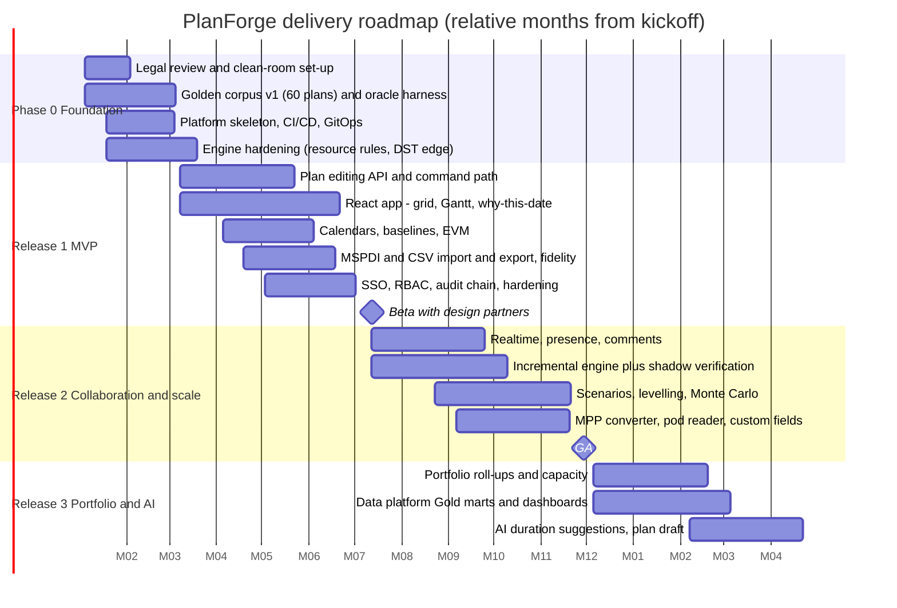

# 16 · Delivery Roadmap, Team and Risks

> **Estimates are rough orders of magnitude** from the design's scope, not a bottom-up plan; they assume a stable team and no hard external dependencies. Re-baseline after Phase 0.

## 1. Phases

| Phase | Goal | Exit criteria (all must hold) |
|---|---|---|
| **0 Foundation** (~3 mo) | De-risk legal, correctness, delivery | Counsel sign-off on clean-room protocol; corpus v1 with ≥ 60 plans and oracle harness; engine ≥ 95 % corpus parity on in-scope features; CI/CD + preview envs live; ADR-001…013 ratified or amended |
| **R1 MVP** (~4–5 mo) | A scheduler can build, baseline, track and export a plan on the web | FR *Must* items in 1.1/1.2/1.3 (R1); NFR-PERF-01/02, NFR-ACC-01, NFR-SEC-01..03 met; ≥ 3 design partners run a real project; fidelity report on 10 customer MPP/MSPDI files |
| **R2** (~5 mo) | Teams collaborate; plans scale; analyses | 50 concurrent editors soak test with zero lost updates; incremental engine matches full recompute on 1 M random edits; NFR-PERF-03 met; SLOs live; pen-test findings closed |
| **R3** (~3–4 mo) | Portfolio insight and AI assist | Gold marts reconcile with plan data (DQ gates green); model card approved; AI acceptance & coverage dashboards live |

## 2. Team shape (indicative, ~12 FTE at peak)
| Role | FTE | Focus |
|---|---:|---|
| Tech lead / architect | 1 | Boundaries, ADRs, reviews |
| Engine & domain engineers | 2 | Engine, corpus, importers |
| Backend engineers | 3 | API, persistence, realtime, workers |
| Frontend engineers | 3 | Grid, canvas Gantt, a11y |
| Platform/SRE | 1.5 | Kubernetes, GitOps, observability |
| Data/ML engineer | 1 (R3: 2) | Pipelines, feature store, models |
| Security engineer (part-time) | 0.5 | Threat model, pen test liaison |
| Product + UX | 1.5 | Research with schedulers, design system |
| QA/SDET | 1 | E2E, performance, a11y |

## 3. Risk register

Scores: Likelihood (L) and Impact (I) 1–5; exposure = L × I.

| ID | Risk | L | I | Exp | Mitigation | Owner |
|---|---|:-:|:-:|:-:|---|---|
| R-01 | Legal challenge or contamination of clean-room (legacy code seen by implementers) | 2 | 5 | 10 | Counsel review; two-team protocol; evidence log; implementers work from specs + numeric corpus only | Legal / Tech lead |
| R-02 | Scheduling parity gaps vs. user expectations (undocumented edge behaviours) | 4 | 4 | 16 | Golden corpus early; deviation catalogue; design-partner pilots; “Why this date” builds trust where we differ | Engine lead |
| R-03 | Incremental engine bugs cause wrong dates | 3 | 5 | 15 | Full-vs-incremental oracle in CI and prod shadow mode; feature flag; auto-fallback to full recompute on mismatch | Engine lead |
| R-04 | Real-time collaboration complexity (conflicts, lost updates) | 3 | 4 | 12 | Server-sequenced log, commute rules, property tests on rebase, soak/chaos tests | Backend lead |
| R-05 | Gantt performance/accessibility at 50 k rows | 3 | 3 | 9 | Early spike (Phase 0) with budgets; canvas + treegrid mirror; scroll traces in CI | Frontend lead |
| R-06 | Import fidelity disappoints (MPP variants, splits, formulas) | 4 | 3 | 12 | Fidelity report; MSPDI-first; MPXJ isolated; roadmap for splits | Product |
| R-07 | Security incident via file import or webhook SSRF | 2 | 5 | 10 | Sandbox, quarantine, SSRF controls, fuzzing, pen test | Security |
| R-08 | Scope creep toward a full MS Project clone | 4 | 3 | 12 | Non-goals in doc 02; MoSCoW gate at each phase review | Product |
| R-09 | Multi-tenant noisy neighbour / RLS misconfiguration | 2 | 5 | 10 | RLS tests in CI, per-tenant quotas/bulkheads, dedicated-DB option for large tenants | Platform |
| R-10 | AI features create automation bias or privacy issues | 3 | 3 | 9 | Advisory-only, model card, opt-in, redaction, governance gate | Data/ML |
| R-11 | Key-person dependency on engine knowledge | 3 | 4 | 12 | Engine design doc + corpus + property tests are the knowledge store; pair rotation | Tech lead |
| R-12 | Estimates optimistic (rewrite effort) | 4 | 3 | 12 | Re-baseline after Phase 0; thin vertical slices; Phase 0 timeboxed | PM |
| R-13 | Licensing decision (ADR-011) delayed → blocks open-sourcing the engine | 3 | 2 | 6 | Decide before R1 beta; engine repo kept separable | Exec sponsor |

## 4. Open decisions (need an owner)
1. **Licence model** (ADR-011).
2. **Target buyer first:** PMO-led enterprise vs. team-led SMB (drives SSO/SCIM priority vs. self-serve onboarding).
3. **Hosting model for R1:** SaaS-first vs. self-hosted-first (changes operational maturity needed).
4. **Reference oracle:** which trusted reference generates corpus expected values, given licence terms of any proprietary tool used for that purpose.
5. **Data residency regions** at launch.
6. **Product name** (trademark search).

## 5. First 30 days — concrete next actions
1. Engage counsel on ADR-001 and the clean-room protocol; appoint analyst and implementer groups.
2. Stand up the repository from this pack (`engine/`, `api/`, `db/`, `docs/`) and wire `.github/workflows/ci.yml`.
3. Build the **oracle harness** and collect the first 30 corpus plans (start with the three sample plans shipped in the legacy repo).
4. Extend the engine with fixed-units/duration/work rules and calendar inheritance; keep the property test green.
5. Run a 2-week **Gantt spike** (canvas + treegrid) against the 50 k-row budget.
6. Recruit 3 design-partner schedulers; schedule weekly reviews of “Why this date”.
